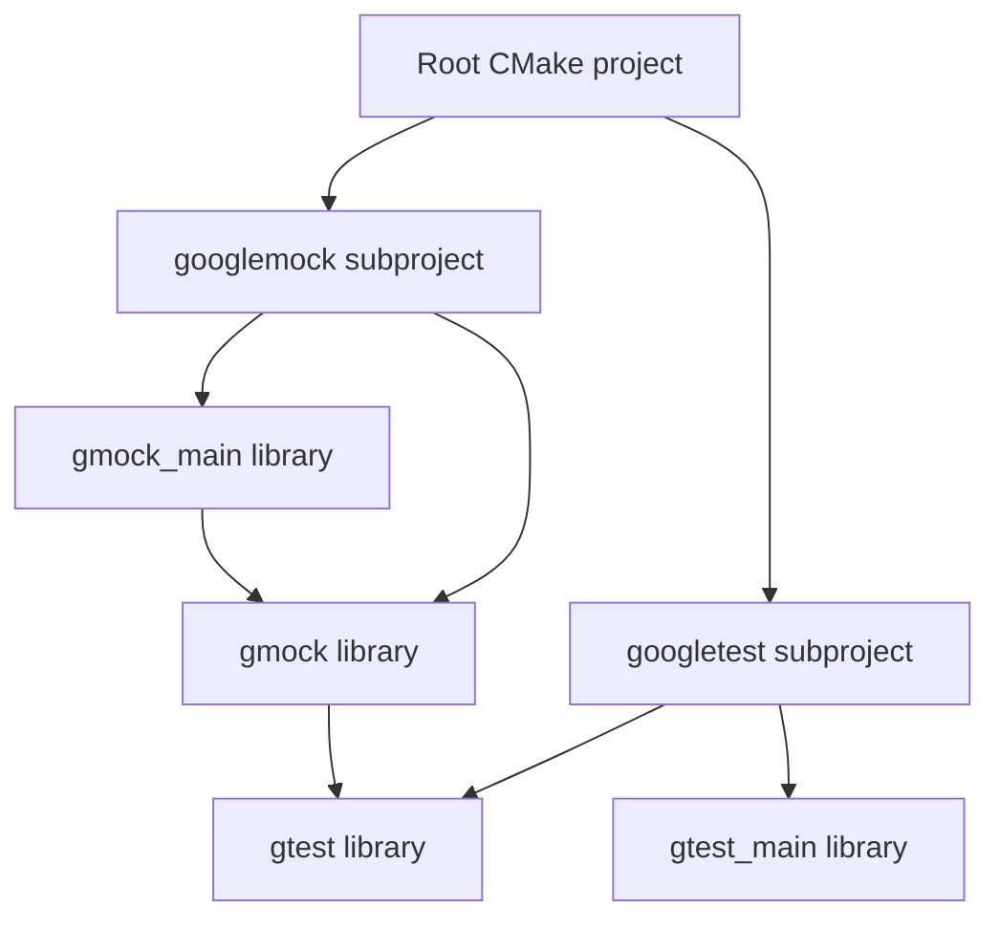

<!-- PAGE_ID: googletest_01_project_overview -->

相关源码文件

本页引用以下源码与项目文档：

- ([README.md:11-32](https://github.com/maxiaoxuxu/googletest/blob/a8380b01a25ebdb130097b607b3afed2a58d04ba/README.md#L11-L32))
- ([CMakeLists.txt:1-35](https://github.com/maxiaoxuxu/googletest/blob/a8380b01a25ebdb130097b607b3afed2a58d04ba/CMakeLists.txt#L1-L35))
- ([CMakeLists.txt:110-156](https://github.com/maxiaoxuxu/googletest/blob/a8380b01a25ebdb130097b607b3afed2a58d04ba/googletest/CMakeLists.txt#L110-L156))
- ([CMakeLists.txt:68-118](https://github.com/maxiaoxuxu/googletest/blob/a8380b01a25ebdb130097b607b3afed2a58d04ba/googlemock/CMakeLists.txt#L68-L118))
- ([gtest-all.cc:40-50](https://github.com/maxiaoxuxu/googletest/blob/a8380b01a25ebdb130097b607b3afed2a58d04ba/googletest/src/gtest-all.cc#L40-L50))
- ([gmock-all.cc:41-47](https://github.com/maxiaoxuxu/googletest/blob/a8380b01a25ebdb130097b607b3afed2a58d04ba/googlemock/src/gmock-all.cc#L41-L47))

# 项目总览与模块边界

> **相关页面**：[TEST 宏与测试注册](./02_registration.md) · [RUN_ALL_TESTS 执行路径](./03_execution.md) · [Fixture、Environment 与事件监听](./04_fixtures_environment.md) · [构建与项目自测](./11_build_testing.md)

---

<!-- BEGIN:AUTOGEN googletest_01_project_overview_main -->
## 项目总览与模块边界

## 仓库定位

GoogleTest 是 C++ 测试框架，GoogleMock 是与之配套的 Mock 框架。仓库 README 明确说明这两个项目从原先独立仓库合并维护；当前版本为 1.18.0，1.18.x 要求 C++17。([README.md:11-32](https://github.com/maxiaoxuxu/googletest/blob/a8380b01a25ebdb130097b607b3afed2a58d04ba/README.md#L11-L32))

两部分职责可以这样区分：

| 子系统 | 主要解决的问题 | 常用入口 |
|---|---|---|
| GoogleTest | 怎么声明测试、安排执行、记录断言和汇总结果 | `TEST`、`TEST_F`、`EXPECT_*`、`ASSERT_*`、`RUN_ALL_TESTS` |
| GoogleMock | 怎么替换被测对象的依赖、定义调用期望并提供模拟返回行为 | `MOCK_METHOD`、`EXPECT_CALL`、`ON_CALL`、Matcher、Action |

## 目录和编译单元

- `googletest/include/gtest/` 是公开接口；`googletest/src/` 是注册、执行、结果和平台适配实现。
- `googlemock/include/gmock/` 是 Mock API；`googlemock/src/` 实现 Mock 注册和期望管理。
- `googletest/test/` 与 `googlemock/test/` 存放框架自身测试。

`gtest-all.cc` 和 `gmock-all.cc` 是聚合编译单元，会 include 多个真实实现文件，不是平行的第二套实现。([gtest-all.cc:40-50](https://github.com/maxiaoxuxu/googletest/blob/a8380b01a25ebdb130097b607b3afed2a58d04ba/gtest-all.cc#L40-L50)) ([gmock-all.cc:41-47](https://github.com/maxiaoxuxu/googletest/blob/a8380b01a25ebdb130097b607b3afed2a58d04ba/gmock-all.cc#L41-L47))

## CMake 目标关系

根构建通过 `BUILD_GMOCK` 控制是否加入 GoogleMock；默认值为 ON。GoogleMock 的 CMake 子项目会把 GoogleTest 加入构建。([CMakeLists.txt:19-35](https://github.com/maxiaoxuxu/googletest/blob/a8380b01a25ebdb130097b607b3afed2a58d04ba/CMakeLists.txt#L19-L35)) ([CMakeLists.txt:11-18](https://github.com/maxiaoxuxu/googletest/blob/a8380b01a25ebdb130097b607b3afed2a58d04ba/gmock/CMakeLists.txt#L11-L18))

- `gtest`：核心测试框架库。
- `gtest_main`：默认测试入口，链接 `gtest`。
- `gmock`：Mock 框架库；常规非 MSVC 路径下链接 `gtest`。
- `gmock_main`：默认 Mock 测试入口，链接 `gmock`。([CMakeLists.txt:110-156](https://github.com/maxiaoxuxu/googletest/blob/a8380b01a25ebdb130097b607b3afed2a58d04ba/googletest/CMakeLists.txt#L110-L156)) ([CMakeLists.txt:68-118](https://github.com/maxiaoxuxu/googletest/blob/a8380b01a25ebdb130097b607b3afed2a58d04ba/googlemock/CMakeLists.txt#L68-L118))

**阅读主线**：先看 GoogleTest 的声明、注册和执行，再看 GoogleMock 如何通过 GTest 的结果通道报告交互错误。

**Sources**：([README.md:11-32](https://github.com/maxiaoxuxu/googletest/blob/a8380b01a25ebdb130097b607b3afed2a58d04ba/README.md#L11-L32))、([CMakeLists.txt:1-35](https://github.com/maxiaoxuxu/googletest/blob/a8380b01a25ebdb130097b607b3afed2a58d04ba/CMakeLists.txt#L1-L35))、([CMakeLists.txt:110-156](https://github.com/maxiaoxuxu/googletest/blob/a8380b01a25ebdb130097b607b3afed2a58d04ba/googletest/CMakeLists.txt#L110-L156))、([CMakeLists.txt:68-118](https://github.com/maxiaoxuxu/googletest/blob/a8380b01a25ebdb130097b607b3afed2a58d04ba/googlemock/CMakeLists.txt#L68-L118))、([gtest-all.cc:40-50](https://github.com/maxiaoxuxu/googletest/blob/a8380b01a25ebdb130097b607b3afed2a58d04ba/googletest/src/gtest-all.cc#L40-L50))、([gmock-all.cc:41-47](https://github.com/maxiaoxuxu/googletest/blob/a8380b01a25ebdb130097b607b3afed2a58d04ba/googlemock/src/gmock-all.cc#L41-L47))
<!-- END:AUTOGEN googletest_01_project_overview_main -->

---
