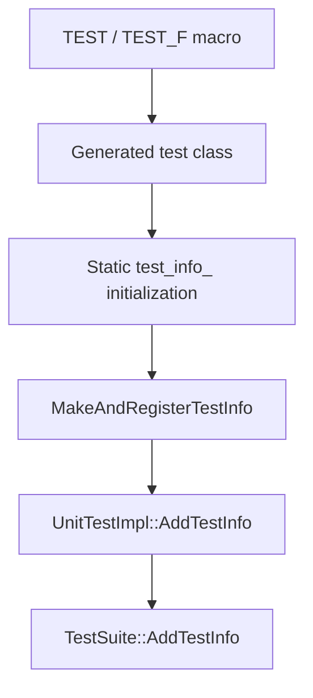

<!-- PAGE_ID: googletest_02_registration -->

相关源码文件

本页引用以下源码与项目文档：

- ([gtest.h:2200-2239](https://github.com/maxiaoxuxu/googletest/blob/a8380b01a25ebdb130097b607b3afed2a58d04ba/googletest/include/gtest/gtest.h#L2200-L2239))
- ([gtest-internal.h:1515-1558](https://github.com/maxiaoxuxu/googletest/blob/a8380b01a25ebdb130097b607b3afed2a58d04ba/googletest/include/gtest/internal/gtest-internal.h#L1515-L1558))
- ([gtest.cc:2848-2861](https://github.com/maxiaoxuxu/googletest/blob/a8380b01a25ebdb130097b607b3afed2a58d04ba/googletest/src/gtest.cc#L2848-L2861))
- ([gtest-internal-inl.h:660-690](https://github.com/maxiaoxuxu/googletest/blob/a8380b01a25ebdb130097b607b3afed2a58d04ba/googletest/src/gtest-internal-inl.h#L660-L690))

# TEST 宏与测试注册

> **相关页面**：[项目总览与模块边界](./01_project_overview.md) · [RUN_ALL_TESTS 执行路径](./03_execution.md) · [Fixture、Environment 与事件监听](./04_fixtures_environment.md)

---

<!-- BEGIN:AUTOGEN googletest_02_registration_main -->
## TEST 宏与测试注册

## TEST 宏展开后做了什么

用户写下 `TEST(MathTest, AddsNumbers)` 时，宏最终转到 `GTEST_TEST_`。它会生成一个继承自 `testing::Test` 的测试类，实现虚函数 `TestBody()`，并定义静态成员 `test_info_`。静态成员初始化时调用 `MakeAndRegisterTestInfo(...)`。([gtest.h:2200-2239](https://github.com/maxiaoxuxu/googletest/blob/a8380b01a25ebdb130097b607b3afed2a58d04ba/gtest.h#L2200-L2239)) ([gtest-internal.h:1515-1558](https://github.com/maxiaoxuxu/googletest/blob/a8380b01a25ebdb130097b607b3afed2a58d04ba/gtest-internal.h#L1515-L1558))

因此，普通 TEST/TEST_F 的注册发生在程序启动阶段的静态初始化期间，而不是 `RUN_ALL_TESTS()` 扫描源文件时发生。

## 注册对象分工

| 对象 | 保存的信息和职责 |
|---|---|
| `TestInfo` | 单个测试的名字、源位置、Fixture 类型 ID、Factory、过滤状态和结果 |
| `TestSuite` | 一组同名测试，负责 suite 级 SetUp/TearDown 和顺序 |
| `UnitTestImpl` | 全局内部注册表，按 suite 名查找或创建 TestSuite |

`MakeAndRegisterTestInfo` 创建 `TestInfo` 后调用 `UnitTestImpl::AddTestInfo`；后者获取对应的 TestSuite，再将 TestInfo 加入该 suite。([gtest.cc:2848-2861](https://github.com/maxiaoxuxu/googletest/blob/a8380b01a25ebdb130097b607b3afed2a58d04ba/gtest.cc#L2848-L2861)) ([gtest-internal-inl.h:660-690](https://github.com/maxiaoxuxu/googletest/blob/a8380b01a25ebdb130097b607b3afed2a58d04ba/gtest-internal-inl.h#L660-L690)) ([gtest.h:534-620](https://github.com/maxiaoxuxu/googletest/blob/a8380b01a25ebdb130097b607b3afed2a58d04ba/gtest.h#L534-L620))

## 为什么需要 Factory

注册阶段只需要记录“如何创建这条测试”，不需要马上创建 Fixture。TestInfo 持有 TestFactoryBase，真正执行到该测试时才通过 Factory 创建对象。这样同一套测试元数据可以被过滤、列举、分片或实际执行。([gtest.h:609-665](https://github.com/maxiaoxuxu/googletest/blob/a8380b01a25ebdb130097b607b3afed2a58d04ba/gtest.h#L609-L665)) ([gtest.cc:2897-2935](https://github.com/maxiaoxuxu/googletest/blob/a8380b01a25ebdb130097b607b3afed2a58d04ba/gtest.cc#L2897-L2935))

**Sources**：([gtest.h:2200-2239](https://github.com/maxiaoxuxu/googletest/blob/a8380b01a25ebdb130097b607b3afed2a58d04ba/googletest/include/gtest/gtest.h#L2200-L2239))、([gtest-internal.h:1515-1558](https://github.com/maxiaoxuxu/googletest/blob/a8380b01a25ebdb130097b607b3afed2a58d04ba/googletest/include/gtest/internal/gtest-internal.h#L1515-L1558))、([gtest.cc:2848-2861](https://github.com/maxiaoxuxu/googletest/blob/a8380b01a25ebdb130097b607b3afed2a58d04ba/googletest/src/gtest.cc#L2848-L2861))、([gtest-internal-inl.h:660-690](https://github.com/maxiaoxuxu/googletest/blob/a8380b01a25ebdb130097b607b3afed2a58d04ba/googletest/src/gtest-internal-inl.h#L660-L690))
<!-- END:AUTOGEN googletest_02_registration_main -->

---
