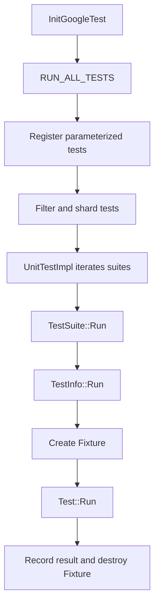

<!-- PAGE_ID: googletest_03_execution -->

相关源码文件

本页引用以下源码与项目文档：

- ([gtest_main.cc:53-65](https://github.com/maxiaoxuxu/googletest/blob/a8380b01a25ebdb130097b607b3afed2a58d04ba/googletest/src/gtest_main.cc#L53-L65))
- ([gtest.cc:2897-2935](https://github.com/maxiaoxuxu/googletest/blob/a8380b01a25ebdb130097b607b3afed2a58d04ba/googletest/src/gtest.cc#L2897-L2935))
- ([gtest.cc:3055-3125](https://github.com/maxiaoxuxu/googletest/blob/a8380b01a25ebdb130097b607b3afed2a58d04ba/googletest/src/gtest.cc#L3055-L3125))
- ([gtest.cc:5936-6015](https://github.com/maxiaoxuxu/googletest/blob/a8380b01a25ebdb130097b607b3afed2a58d04ba/googletest/src/gtest.cc#L5936-L6015))
- ([gtest.cc:6030-6095](https://github.com/maxiaoxuxu/googletest/blob/a8380b01a25ebdb130097b607b3afed2a58d04ba/googletest/src/gtest.cc#L6030-L6095))

# RUN_ALL_TESTS 执行路径

> **相关页面**：[TEST 宏与测试注册](./02_registration.md) · [Fixture、Environment 与事件监听](./04_fixtures_environment.md) · [断言与结果收集](./05_assertions_results.md) · [参数化、Typed、Death 与动态测试](./06_test_variants.md)

---

<!-- BEGIN:AUTOGEN googletest_03_execution_main -->
## RUN_ALL_TESTS 执行路径

## 从 main 到 RunAllTests

默认入口 `gtest_main.cc` 先调用 `testing::InitGoogleTest(&argc, argv)`，再返回 `RUN_ALL_TESTS()` 的结果。([gtest_main.cc:53-65](https://github.com/maxiaoxuxu/googletest/blob/a8380b01a25ebdb130097b607b3afed2a58d04ba/googletest/src/gtest_main.cc#L53-L65))

`UnitTestImpl::RunAllTests()` 负责初始化、扩展参数化测试、处理 sharding、过滤测试，以及 `--gtest_list_tests` 等选项。过滤完成后进入执行循环，逐个遍历 TestSuite。([gtest.cc:5936-6015](https://github.com/maxiaoxuxu/googletest/blob/a8380b01a25ebdb130097b607b3afed2a58d04ba/googletest/src/gtest.cc#L5936-L6015)) ([gtest.cc:6030-6095](https://github.com/maxiaoxuxu/googletest/blob/a8380b01a25ebdb130097b607b3afed2a58d04ba/googletest/src/gtest.cc#L6030-L6095))

## Suite 与单项测试的调用层次

- `TestSuite::Run()` 对 TestInfo 按源文件名和行号稳定排序，再调用 suite 级事件通知和 `SetUpTestSuite()`。
- 随后它逐项调用 `TestInfo::Run()`；若开启 fail-fast，当前项失败后会跳过剩余项。
- `TestInfo::Run()` 通过 Factory 创建 Fixture，执行测试、析构 Fixture，并发送测试结束事件。([gtest.cc:3055-3125](https://github.com/maxiaoxuxu/googletest/blob/a8380b01a25ebdb130097b607b3afed2a58d04ba/googletest/src/gtest.cc#L3055-L3125)) ([gtest.cc:2897-2935](https://github.com/maxiaoxuxu/googletest/blob/a8380b01a25ebdb130097b607b3afed2a58d04ba/googletest/src/gtest.cc#L2897-L2935))

## 一个重要边界：核心调度不是自动并行

当前源码的 `RunAllTests()` 与 `TestSuite::Run()` 都通过普通循环逐个调用 suite/test。它们本身不是“每个 TEST 自动创建一个线程”的并行调度器。外部测试运行器可以通过 shard 环境变量把测试二进制拆成多个进程，但那是另一层调度。([gtest.cc:6030-6095](https://github.com/maxiaoxuxu/googletest/blob/a8380b01a25ebdb130097b607b3afed2a58d04ba/googletest/src/gtest.cc#L6030-L6095)) ([gtest.cc:6170-6260](https://github.com/maxiaoxuxu/googletest/blob/a8380b01a25ebdb130097b607b3afed2a58d04ba/googletest/src/gtest.cc#L6170-L6260))

**Sources**：([gtest_main.cc:53-65](https://github.com/maxiaoxuxu/googletest/blob/a8380b01a25ebdb130097b607b3afed2a58d04ba/googletest/src/gtest_main.cc#L53-L65))、([gtest.cc:2897-2935](https://github.com/maxiaoxuxu/googletest/blob/a8380b01a25ebdb130097b607b3afed2a58d04ba/googletest/src/gtest.cc#L2897-L2935))、([gtest.cc:3055-3125](https://github.com/maxiaoxuxu/googletest/blob/a8380b01a25ebdb130097b607b3afed2a58d04ba/googletest/src/gtest.cc#L3055-L3125))、([gtest.cc:5936-6015](https://github.com/maxiaoxuxu/googletest/blob/a8380b01a25ebdb130097b607b3afed2a58d04ba/googletest/src/gtest.cc#L5936-L6015))、([gtest.cc:6030-6095](https://github.com/maxiaoxuxu/googletest/blob/a8380b01a25ebdb130097b607b3afed2a58d04ba/googletest/src/gtest.cc#L6030-L6095))
<!-- END:AUTOGEN googletest_03_execution_main -->

---
