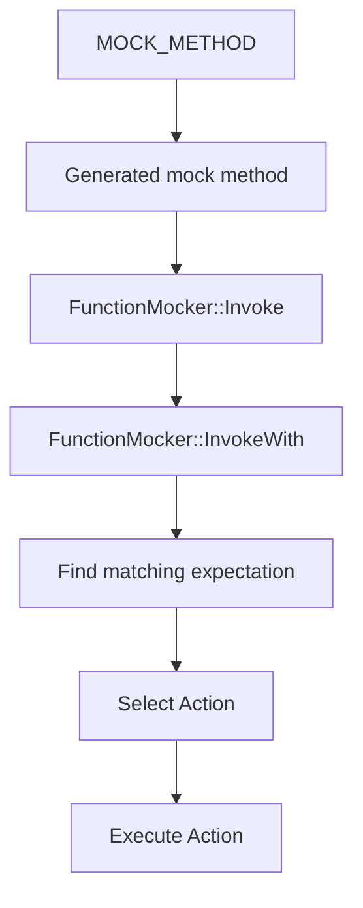

<!-- PAGE_ID: googletest_07_gmock_runtime -->

相关源码文件

本页引用以下源码与项目文档：

- ([gmock.h:56-65](https://github.com/maxiaoxuxu/googletest/blob/a8380b01a25ebdb130097b607b3afed2a58d04ba/googlemock/include/gmock/gmock.h#L56-L65))
- ([gmock-function-mocker.h:112-139](https://github.com/maxiaoxuxu/googletest/blob/a8380b01a25ebdb130097b607b3afed2a58d04ba/googlemock/include/gmock/gmock-function-mocker.h#L112-L139))
- ([gmock-function-mocker.h:141-174](https://github.com/maxiaoxuxu/googletest/blob/a8380b01a25ebdb130097b607b3afed2a58d04ba/googlemock/include/gmock/gmock-function-mocker.h#L141-L174))
- ([gmock-spec-builders.h:1540-1575](https://github.com/maxiaoxuxu/googletest/blob/a8380b01a25ebdb130097b607b3afed2a58d04ba/googlemock/include/gmock/gmock-spec-builders.h#L1540-L1575))
- ([gmock-spec-builders.h:1627-1692](https://github.com/maxiaoxuxu/googletest/blob/a8380b01a25ebdb130097b607b3afed2a58d04ba/googlemock/include/gmock/gmock-spec-builders.h#L1627-L1692))
- ([gmock-spec-builders.h:1730-1845](https://github.com/maxiaoxuxu/googletest/blob/a8380b01a25ebdb130097b607b3afed2a58d04ba/googlemock/include/gmock/gmock-spec-builders.h#L1730-L1845))

# GoogleMock 运行时

> **相关页面**：[项目总览与模块边界](./01_project_overview.md) · [Action 动作模型](./09_actions.md) · [Matcher 匹配器机制](./10_matchers.md) · [构建与项目自测](./11_build_testing.md)

---

<!-- BEGIN:AUTOGEN googletest_07_gmock_runtime_main -->
## GoogleMock 运行时

## GMock 是建立在 GTest 之上的交互验证层

`gmock/gmock.h` 导出 actions、matchers、function mocker 和 spec builder 等主要组件。Mock 期望失败通过 GTest 的失败/日志机制报告；它不是另一个独立的测试总调度器。([gmock.h:56-65](https://github.com/maxiaoxuxu/googletest/blob/a8380b01a25ebdb130097b607b3afed2a58d04ba/googlemock/include/gmock/gmock.h#L56-L65)) ([gmock-spec-builders.cc:389-425](https://github.com/maxiaoxuxu/googletest/blob/a8380b01a25ebdb130097b607b3afed2a58d04ba/googlemock/src/gmock-spec-builders.cc#L389-L425))

## MOCK_METHOD 宏生成什么

`MOCK_METHOD(Return, Method, (Args...), (Spec))` 首先检查参数个数、参数括号、函数签名和修饰符，然后展开到 `GMOCK_INTERNAL_MOCK_METHOD_IMPL`。生成的方法在被调用时委托给对应的 FunctionMocker。([gmock-function-mocker.h:112-139](https://github.com/maxiaoxuxu/googletest/blob/a8380b01a25ebdb130097b607b3afed2a58d04ba/googlemock/include/gmock/gmock-function-mocker.h#L112-L139)) ([gmock-function-mocker.h:141-174](https://github.com/maxiaoxuxu/googletest/blob/a8380b01a25ebdb130097b607b3afed2a58d04ba/googlemock/include/gmock/gmock-function-mocker.h#L141-L174))

这解释了为什么 MOCK_METHOD 不只是声明一个虚函数：它还生成匹配器入口、MockSpec 和 FunctionMocker 成员。

## 调用路径

`FunctionMocker::Invoke()` 会把参数整理为 tuple，再进入 `InvokeWith()`。有 expectation 时，框架在全局 gMock 锁保护下寻找匹配项、更新调用次数并取得 Action；真正执行 Action 时会离开临界区，因为 Action 可能调用任意用户代码甚至再次调用 Mock。([gmock-spec-builders.h:1540-1575](https://github.com/maxiaoxuxu/googletest/blob/a8380b01a25ebdb130097b607b3afed2a58d04ba/googlemock/include/gmock/gmock-spec-builders.h#L1540-L1575)) ([gmock-spec-builders.h:1627-1665](https://github.com/maxiaoxuxu/googletest/blob/a8380b01a25ebdb130097b607b3afed2a58d04ba/googlemock/include/gmock/gmock-spec-builders.h#L1627-L1665))

若没有设置任何 expectation，则会走 uninteresting-call/default-action 路径；严格程度取决于 Mock 的行为策略。([gmock-spec-builders.h:1730-1845](https://github.com/maxiaoxuxu/googletest/blob/a8380b01a25ebdb130097b607b3afed2a58d04ba/googlemock/include/gmock/gmock-spec-builders.h#L1730-L1845))

**Sources**：([gmock.h:56-65](https://github.com/maxiaoxuxu/googletest/blob/a8380b01a25ebdb130097b607b3afed2a58d04ba/googlemock/include/gmock/gmock.h#L56-L65))、([gmock-function-mocker.h:112-139](https://github.com/maxiaoxuxu/googletest/blob/a8380b01a25ebdb130097b607b3afed2a58d04ba/googlemock/include/gmock/gmock-function-mocker.h#L112-L139))、([gmock-function-mocker.h:141-174](https://github.com/maxiaoxuxu/googletest/blob/a8380b01a25ebdb130097b607b3afed2a58d04ba/googlemock/include/gmock/gmock-function-mocker.h#L141-L174))、([gmock-spec-builders.h:1540-1575](https://github.com/maxiaoxuxu/googletest/blob/a8380b01a25ebdb130097b607b3afed2a58d04ba/googlemock/include/gmock/gmock-spec-builders.h#L1540-L1575))、([gmock-spec-builders.h:1627-1692](https://github.com/maxiaoxuxu/googletest/blob/a8380b01a25ebdb130097b607b3afed2a58d04ba/googlemock/include/gmock/gmock-spec-builders.h#L1627-L1692))、([gmock-spec-builders.h:1730-1845](https://github.com/maxiaoxuxu/googletest/blob/a8380b01a25ebdb130097b607b3afed2a58d04ba/googlemock/include/gmock/gmock-spec-builders.h#L1730-L1845))
<!-- END:AUTOGEN googletest_07_gmock_runtime_main -->

---
