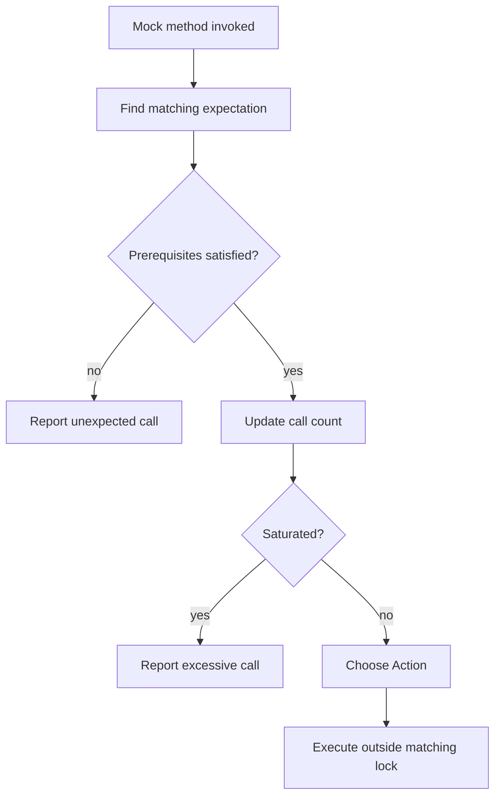

<!-- PAGE_ID: googletest_08_expectations -->

相关源码文件

本页引用以下源码与项目文档：

- ([gmock-spec-builders.h:32-57](https://github.com/maxiaoxuxu/googletest/blob/a8380b01a25ebdb130097b607b3afed2a58d04ba/googlemock/include/gmock/gmock-spec-builders.h#L32-L57))
- ([gmock-spec-builders.h:790-815](https://github.com/maxiaoxuxu/googletest/blob/a8380b01a25ebdb130097b607b3afed2a58d04ba/googlemock/include/gmock/gmock-spec-builders.h#L790-L815))
- ([gmock-spec-builders.h:1218-1262](https://github.com/maxiaoxuxu/googletest/blob/a8380b01a25ebdb130097b607b3afed2a58d04ba/googlemock/include/gmock/gmock-spec-builders.h#L1218-L1262))
- ([gmock-spec-builders.h:1643-1692](https://github.com/maxiaoxuxu/googletest/blob/a8380b01a25ebdb130097b607b3afed2a58d04ba/googlemock/include/gmock/gmock-spec-builders.h#L1643-L1692))
- ([gmock-spec-builders.cc:389-425](https://github.com/maxiaoxuxu/googletest/blob/a8380b01a25ebdb130097b607b3afed2a58d04ba/googlemock/src/gmock-spec-builders.cc#L389-L425))

# Expectation 匹配与调用约束

> **相关页面**：[GoogleMock 运行时](./07_gmock_runtime.md) · [Action 动作模型](./09_actions.md) · [Matcher 匹配器机制](./10_matchers.md)

---

<!-- BEGIN:AUTOGEN googletest_08_expectations_main -->
## Expectation 匹配与调用约束

## EXPECT_CALL 与 ON_CALL 的区别

- `EXPECT_CALL(mock, Method(...))` 建立一个可验证的调用期望。
- `ON_CALL(mock, Method(...))` 配置匹配调用时的默认行为，但它本身不等于“必须调用”。

EXPECT_CALL 的常见子句包括 `.With()`、`.Times()`、`.InSequence()`、`.After()`、`.WillOnce()`、`.WillRepeatedly()` 和 `.RetiresOnSaturation()`。([gmock-spec-builders.h:32-57](https://github.com/maxiaoxuxu/googletest/blob/a8380b01a25ebdb130097b607b3afed2a58d04ba/gmock-spec-builders.h#L32-L57))

## 匹配、调用计数和饱和

`FindMatchingExpectationLocked()` 按 expectation 的反向注册顺序遍历，找到第一个参数匹配并可处理本次调用的 expectation。([gmock-spec-builders.h:1643-1692](https://github.com/maxiaoxuxu/googletest/blob/a8380b01a25ebdb130097b607b3afed2a58d04ba/gmock-spec-builders.h#L1643-L1692))

匹配成功后，`GetActionForArguments()` 会检查是否已经达到 Times 上限；未饱和时增加调用次数、退休前置 expectation，并按调用序号选取 Action。超过上限则记录 excessive call 并走默认行为。([gmock-spec-builders.h:1218-1262](https://github.com/maxiaoxuxu/googletest/blob/a8380b01a25ebdb130097b607b3afed2a58d04ba/gmock-spec-builders.h#L1218-L1262))

## 顺序约束与前置依赖

`InSequence` / `After` 将 expectation 组织成前置关系。执行某个 expectation 时，框架需要判断其 prerequisites 是否全部满足；源码会遍历前置集合进行检查。([gmock-spec-builders.h:790-815](https://github.com/maxiaoxuxu/googletest/blob/a8380b01a25ebdb130097b607b3afed2a58d04ba/gmock-spec-builders.h#L790-L815)) ([gmock-spec-builders.cc:128-145](https://github.com/maxiaoxuxu/googletest/blob/a8380b01a25ebdb130097b607b3afed2a58d04ba/gmock-spec-builders.cc#L128-L145))

## 期望校验时机

Mock 函数对象销毁时会验证仍然有效的 expectation 是否满足调用次数要求；若不足或超量，框架通过非致命失败报告。([gmock-spec-builders.cc:389-425](https://github.com/maxiaoxuxu/googletest/blob/a8380b01a25ebdb130097b607b3afed2a58d04ba/gmock-spec-builders.cc#L389-L425)) ([gmock-spec-builders.h:1400-1450](https://github.com/maxiaoxuxu/googletest/blob/a8380b01a25ebdb130097b607b3afed2a58d04ba/gmock-spec-builders.h#L1400-L1450))

**Sources**：([gmock-spec-builders.h:32-57](https://github.com/maxiaoxuxu/googletest/blob/a8380b01a25ebdb130097b607b3afed2a58d04ba/googlemock/include/gmock/gmock-spec-builders.h#L32-L57))、([gmock-spec-builders.h:790-815](https://github.com/maxiaoxuxu/googletest/blob/a8380b01a25ebdb130097b607b3afed2a58d04ba/googlemock/include/gmock/gmock-spec-builders.h#L790-L815))、([gmock-spec-builders.h:1218-1262](https://github.com/maxiaoxuxu/googletest/blob/a8380b01a25ebdb130097b607b3afed2a58d04ba/googlemock/include/gmock/gmock-spec-builders.h#L1218-L1262))、([gmock-spec-builders.h:1643-1692](https://github.com/maxiaoxuxu/googletest/blob/a8380b01a25ebdb130097b607b3afed2a58d04ba/googlemock/include/gmock/gmock-spec-builders.h#L1643-L1692))、([gmock-spec-builders.cc:389-425](https://github.com/maxiaoxuxu/googletest/blob/a8380b01a25ebdb130097b607b3afed2a58d04ba/googlemock/src/gmock-spec-builders.cc#L389-L425))
<!-- END:AUTOGEN googletest_08_expectations_main -->

---
