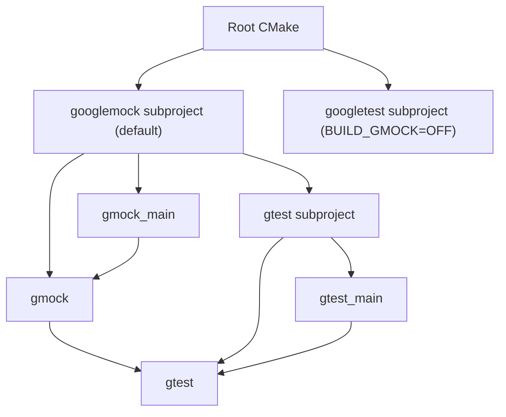

<!-- PAGE_ID: googletest_smoke_01_build_graph -->

# 构建入口与目标依赖

> 本页追踪根 CMake 到 GoogleTest / GoogleMock 库目标的关系。源码基准固定为 `a8380b01a25ebdb130097b607b3afed2a58d04ba`。

<!-- BEGIN:AUTOGEN googletest_smoke_01_build_graph_cmake -->
## CMake 构建入口与库目标

### 根构建入口

仓库根目录的 `CMakeLists.txt` 声明最低 CMake 版本为 3.16，并将项目版本设为 1.18.0。它调用 `enable_testing()`，并通过 `BUILD_GMOCK` 控制是否构建 GoogleMock；该选项默认开启。开启时加入 `googlemock` 子目录，关闭时直接加入 `googletest` 子目录。因此默认构建路径是先进入 GoogleMock 子项目，再由其引入 GoogleTest。([CMakeLists.txt:4-35](https://github.com/maxiaoxuxu/googletest/blob/a8380b01a25ebdb130097b607b3afed2a58d04ba/CMakeLists.txt#L4-L35))

### GoogleTest 库目标

`googletest/CMakeLists.txt` 定义 `gtest` 和 `gtest_main` 两个库目标。`gtest` 以 `src/gtest-all.cc` 为编译输入；`gtest_main` 以 `src/gtest_main.cc` 为入口，并通过 `target_link_libraries(gtest_main PUBLIC gtest)` 依赖核心库。([CMakeLists.txt:110-160](https://github.com/maxiaoxuxu/googletest/blob/a8380b01a25ebdb130097b607b3afed2a58d04ba/googletest/CMakeLists.txt#L110-L160))

### GoogleMock 库目标

`googlemock/CMakeLists.txt` 先解析 GoogleTest 源码目录并将 GoogleTest 子项目加入构建。非 MSVC 分支中，`gmock` 链接 `gtest`，`gmock_main` 链接 `gmock`。MSVC 分支则把 GoogleTest 的聚合源文件与 GoogleMock 源文件一起编译进对应目标。([CMakeLists.txt:68-120](https://github.com/maxiaoxuxu/googletest/blob/a8380b01a25ebdb130097b607b3afed2a58d04ba/googlemock/CMakeLists.txt#L68-L120))

### 目标关系

**结论**：`gtest` 是基础测试框架库，`gtest_main` 提供默认测试入口；`gmock` 建立在 GTest 能力之上，`gmock_main` 再提供 Mock 测试的默认入口。这里描述的是 CMake 目标依赖，不代表本次已执行编译或链接。

**Sources**：根 `CMakeLists.txt`、`googletest/CMakeLists.txt`、`googlemock/CMakeLists.txt`，均固定到上述源码 commit。
<!-- END:AUTOGEN googletest_smoke_01_build_graph_cmake -->
