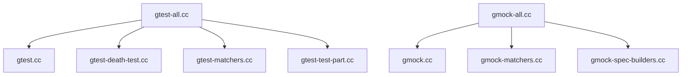

<!-- PAGE_ID: googletest_smoke_02_aggregate_units -->

# 聚合编译单元与模块边界

> 本页区分聚合编译入口与真正承载实现的源文件，避免把 `gtest-all.cc` / `gmock-all.cc` 误解为第二套实现。

<!-- BEGIN:AUTOGEN googletest_smoke_02_aggregate_units_composition -->
## 聚合编译单元的组成

### GoogleTest

`googletest/src/gtest-all.cc` 的注释说明，后续 include 用于拉入真正的 GoogleTest `.cc` 实现文件。列表包括 assertion result、death test、filepath、matchers、platform port、printers、test part、typed test，以及主实现 `gtest.cc`。因此 `gtest-all.cc` 是聚合编译单元，具体实现仍分布在这些被 include 的源文件中。([gtest-all.cc:40-50](https://github.com/maxiaoxuxu/googletest/blob/a8380b01a25ebdb130097b607b3afed2a58d04ba/googletest/src/gtest-all.cc#L40-L50))

### GoogleMock

`googlemock/src/gmock-all.cc` 采用相同组织方式，聚合 cardinalities、internal utils、matchers、spec builders 和 `gmock.cc` 等实现文件。([gmock-all.cc:41-47](https://github.com/maxiaoxuxu/googletest/blob/a8380b01a25ebdb130097b607b3afed2a58d04ba/googlemock/src/gmock-all.cc#L41-L47))

### 结构示意

**源码事实**：两个聚合文件都通过 include 汇入实现文件。
**推导**：在采用聚合构建方式时，编译入口集中，但实现职责仍按功能文件拆分。该组织方式有利于控制构建单元数量，但不应据此推断运行时模块边界或 ABI 边界。

**Sources**：`googletest/src/gtest-all.cc`、`googlemock/src/gmock-all.cc`。
<!-- END:AUTOGEN googletest_smoke_02_aggregate_units_composition -->
