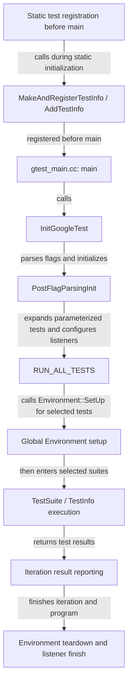
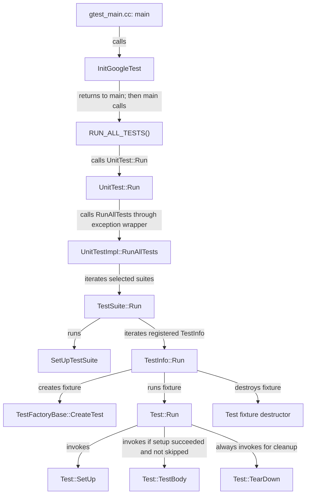
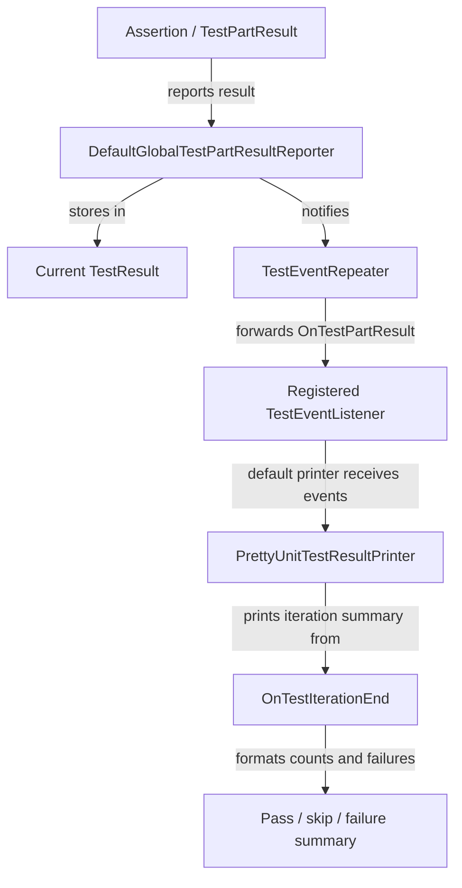

<!-- PAGE_ID: googletest_03_test_execution_lifecycle -->

📚 Relevant source files

- [gtest_main.cc:59-65](https://github.com/maxiaoxuxu/googletest/blob/277cfa07d637aac85a388d1cb0c6adb585a1432e/googletest/src/gtest_main.cc#L59-L65)
- [gtest.h:2337-2348](https://github.com/maxiaoxuxu/googletest/blob/277cfa07d637aac85a388d1cb0c6adb585a1432e/googletest/include/gtest/gtest.h#L2337-L2348)
- [gtest-internal.h:1546-1558](https://github.com/maxiaoxuxu/googletest/blob/277cfa07d637aac85a388d1cb0c6adb585a1432e/googletest/include/gtest/internal/gtest-internal.h#L1546-L1558)
- [gtest-internal-inl.h:670-693](https://github.com/maxiaoxuxu/googletest/blob/277cfa07d637aac85a388d1cb0c6adb585a1432e/googletest/src/gtest-internal-inl.h#L670-L693)
- [gtest.cc:2849-2861](https://github.com/maxiaoxuxu/googletest/blob/277cfa07d637aac85a388d1cb0c6adb585a1432e/googletest/src/gtest.cc#L2849-L2861)
- [gtest.cc:5540-5630](https://github.com/maxiaoxuxu/googletest/blob/277cfa07d637aac85a388d1cb0c6adb585a1432e/googletest/src/gtest.cc#L5540-L5630)
- [gtest.cc:5810-5850](https://github.com/maxiaoxuxu/googletest/blob/277cfa07d637aac85a388d1cb0c6adb585a1432e/googletest/src/gtest.cc#L5810-L5850)
- [gtest.cc:5938-5967](https://github.com/maxiaoxuxu/googletest/blob/277cfa07d637aac85a388d1cb0c6adb585a1432e/googletest/src/gtest.cc#L5938-L5967)
- [gtest.cc:6043-6132](https://github.com/maxiaoxuxu/googletest/blob/277cfa07d637aac85a388d1cb0c6adb585a1432e/googletest/src/gtest.cc#L6043-L6132)
- [gtest.cc:3054-3125](https://github.com/maxiaoxuxu/googletest/blob/277cfa07d637aac85a388d1cb0c6adb585a1432e/googletest/src/gtest.cc#L3054-L3125)
- [gtest.cc:2894-2941](https://github.com/maxiaoxuxu/googletest/blob/277cfa07d637aac85a388d1cb0c6adb585a1432e/googletest/src/gtest.cc#L2894-L2941)
- [gtest.cc:2766-2785](https://github.com/maxiaoxuxu/googletest/blob/277cfa07d637aac85a388d1cb0c6adb585a1432e/googletest/src/gtest.cc#L2766-L2785)
- [gtest.cc:1093-1110](https://github.com/maxiaoxuxu/googletest/blob/277cfa07d637aac85a388d1cb0c6adb585a1432e/googletest/src/gtest.cc#L1093-L1110)
- [gtest.cc:3916-3977](https://github.com/maxiaoxuxu/googletest/blob/277cfa07d637aac85a388d1cb0c6adb585a1432e/googletest/src/gtest.cc#L3916-L3977)
- [gtest.cc:3703-3734](https://github.com/maxiaoxuxu/googletest/blob/277cfa07d637aac85a388d1cb0c6adb585a1432e/googletest/src/gtest.cc#L3703-L3734)

# GoogleTest 测试执行生命周期：从静态注册到结果报告

> **Source baseline**: `277cfa07d637aac85a388d1cb0c6adb585a1432e`

---

<!-- BEGIN:AUTOGEN googletest_03_test_execution_lifecycle_main -->
## 1. 先理解整体：GoogleTest 不是运行时扫描测试文件

这点与用户提供的 pytest 生命周期图有一个关键区别：GoogleTest 的 `TEST` / `TEST_F` 宏会定义静态注册对象；该对象通过 `MakeAndRegisterTestInfo()` 把测试元信息登记到 `UnitTestImpl`。`AddTestInfo()` 的源码注释明确说明，这个注册过程发生在 `main()` 之前。因此，普通 GoogleTest 程序进入 `main()` 时，常规测试项已经通过静态初始化注册；它不是在 `RUN_ALL_TESTS()` 中遍历目录、查找 C++ 文件。[gtest-internal.h:1546-1558](https://github.com/maxiaoxuxu/googletest/blob/277cfa07d637aac85a388d1cb0c6adb585a1432e/googletest/include/gtest/internal/gtest-internal.h#L1546-L1558) [gtest.cc:2849-2861](https://github.com/maxiaoxuxu/googletest/blob/277cfa07d637aac85a388d1cb0c6adb585a1432e/googletest/src/gtest.cc#L2849-L2861) [gtest-internal-inl.h:670-693](https://github.com/maxiaoxuxu/googletest/blob/277cfa07d637aac85a388d1cb0c6adb585a1432e/googletest/src/gtest-internal-inl.h#L670-L693)

参数化测试还有一个额外阶段：`PostFlagParsingInit()` 会调用 `RegisterParameterizedTests()`，把 `TEST_P` / 参数化实例展开并注册成普通测试项。这发生在执行测试套件之前，而不是 pytest 风格的文件收集阶段。[gtest.cc:5810-5850](https://github.com/maxiaoxuxu/googletest/blob/277cfa07d637aac85a388d1cb0c6adb585a1432e/googletest/src/gtest.cc#L5810-L5850)

### 生命周期阶段总览

<!-- DIAGRAM_ID: execution-lifecycle-overview -->

这里的阶段顺序是针对普通平台、常规执行路径的概览。静态注册在进程进入 `main()` 前发生；环境 setup/teardown 受是否选中测试、repeat 配置和提前失败/skip 条件影响，不能把概览图理解为所有分支都无条件执行。

## 2. 入口与初始化：main → InitGoogleTest → PostFlagParsingInit

普通平台的 `gtest_main.cc` 提供 `main(int argc, char** argv)`，先调用 `testing::InitGoogleTest(&argc, argv)`，再调用 `RUN_ALL_TESTS()`。[gtest_main.cc:59-65](https://github.com/maxiaoxuxu/googletest/blob/277cfa07d637aac85a388d1cb0c6adb585a1432e/googletest/src/gtest_main.cc#L59-L65)

`InitGoogleTestImpl()` 保存原始 argv，调用 `ParseGoogleTestFlagsOnly()` 解析 GoogleTest 参数，然后进入 `UnitTestImpl::PostFlagParsingInit()`。后者是幂等初始化：可注册自定义事件 listener、初始化 death-test 子进程控制、注册参数化测试，并配置 XML / brief / streaming 输出 listener。[gtest.cc:7000-7044](https://github.com/maxiaoxuxu/googletest/blob/277cfa07d637aac85a388d1cb0c6adb585a1432e/googletest/src/gtest.cc#L7000-L7044) [gtest.cc:5810-5850](https://github.com/maxiaoxuxu/googletest/blob/277cfa07d637aac85a388d1cb0c6adb585a1432e/googletest/src/gtest.cc#L5810-L5850)

`RUN_ALL_TESTS()` 是一个内联包装，最终调用 `UnitTest::GetInstance()->Run()`；公开头文件要求在调用前完成命令行解析，并说明该调用会清理已安装的全局 Environment，且每个测试二进制只应调用一次。[gtest.h:2337-2348](https://github.com/maxiaoxuxu/googletest/blob/277cfa07d637aac85a388d1cb0c6adb585a1432e/googletest/include/gtest/gtest.h#L2337-L2348)

## 3. 调用层级：RUN_ALL_TESTS 到单个测试体

### 主调用链

<!-- DIAGRAM_ID: test-call-hierarchy -->

`UnitTest::Run()` 将真正的执行工作交给 `UnitTestImpl::RunAllTests()`，并把辅助环境/listener 代码放进异常处理包装中；正常返回值映射为进程退出码 0 或 1。[gtest.cc:5540-5630](https://github.com/maxiaoxuxu/googletest/blob/277cfa07d637aac85a388d1cb0c6adb585a1432e/googletest/src/gtest.cc#L5540-L5630)

`RunAllTests()` 负责后置初始化、检查测试是否存在、过滤 / shard / list-tests 处理、repeat / shuffle 策略、迭代事件、全局 Environment 生命周期，以及逐个调用被选中的 TestSuite。[gtest.cc:5938-5967](https://github.com/maxiaoxuxu/googletest/blob/277cfa07d637aac85a388d1cb0c6adb585a1432e/googletest/src/gtest.cc#L5938-L5967) [gtest.cc:6043-6132](https://github.com/maxiaoxuxu/googletest/blob/277cfa07d637aac85a388d1cb0c6adb585a1432e/googletest/src/gtest.cc#L6043-L6132)

`TestSuite::Run()` 先对 TestInfo 按源文件和行号稳定排序，再执行 `SetUpTestSuite()`，循环调用各个 `TestInfo::Run()`，最后执行 `TearDownTestSuite()` 并发送 suite end 事件。[gtest.cc:3054-3125](https://github.com/maxiaoxuxu/googletest/blob/277cfa07d637aac85a388d1cb0c6adb585a1432e/googletest/src/gtest.cc#L3054-L3125)

`TestInfo::Run()` 负责单个测试项：发送 OnTestStart、创建 fixture、运行 fixture、销毁 fixture、记录 elapsed time 并发送 OnTestEnd。若该测试未被选中，函数会直接返回；禁用测试可能触发 OnTestDisabled。[gtest.cc:2894-2941](https://github.com/maxiaoxuxu/googletest/blob/277cfa07d637aac85a388d1cb0c6adb585a1432e/googletest/src/gtest.cc#L2894-L2941)

### 单个 Test 的 setup / body / teardown 规则

`Test::Run()` 先执行 `SetUp()`；只有在 setup 未触发 fatal failure 且测试未 skip 时才执行 `TestBody()`。但 `TearDown()` 用于尽可能清理资源，源码明确说明即使 setup 或 test body 失败也仍然调用它。[gtest.cc:2766-2785](https://github.com/maxiaoxuxu/googletest/blob/277cfa07d637aac85a388d1cb0c6adb585a1432e/googletest/src/gtest.cc#L2766-L2785)

### 全局、Suite、单测试三个生命周期层级

| 生命周期层级 | Setup | 执行对象 | Teardown |
|---|---|---|---|
| 全局 Environment | 每次 iteration 按 repeat 配置执行 | 所有选中的 TestSuite | 按 Environment 注册顺序的逆序清理 |
| TestSuite | `SetUpTestSuite()` | Suite 内各个 TestInfo | `TearDownTestSuite()` |
| 单个 Test | fixture `SetUp()` | `TestBody()` | fixture `TearDown()`，即使 setup/body 失败也会调用 |

全局 Environment 在每次迭代开头按正向顺序执行 setup；在应该清理的迭代末尾通过 reverse iterator 逆序执行 teardown。suite 层的 setup/teardown 位于其测试项循环两端；单测试的 fixture 构造/销毁由 TestInfo 管理。[gtest.cc:6043-6132](https://github.com/maxiaoxuxu/googletest/blob/277cfa07d637aac85a388d1cb0c6adb585a1432e/googletest/src/gtest.cc#L6043-L6132) [gtest.cc:3054-3125](https://github.com/maxiaoxuxu/googletest/blob/277cfa07d637aac85a388d1cb0c6adb585a1432e/googletest/src/gtest.cc#L3054-L3125) [gtest.cc:2894-2941](https://github.com/maxiaoxuxu/googletest/blob/277cfa07d637aac85a388d1cb0c6adb585a1432e/googletest/src/gtest.cc#L2894-L2941)

## 4. 异常、失败、skip 与 fail-fast 分支

- **全局 setup 失败或 skip**：如果全局 Environment setup 产生 fatal failure 或 skip，RunAllTests 不进入普通 suite 执行路径；相关测试会被标记为 skipped。
- **Suite setup 失败或 skip**：`TestSuite::Run()` 检查 suite 的 ad-hoc result；若失败或 skipped，则将该 suite 中的 TestInfo 逐项 Skip。
- **单测试 setup 失败或 skip**：TestInfo 创建 fixture 后检查 fatal failure / skipped 状态；若成立则跳过 Test::Run，不进入 TestBody。Test::Run 内部还会在 Setup 之后再次判断是否应该执行 TestBody。
- **TearDown**：只要进入了 Test::Run，TearDown 就用于尽可能清理，即使 setup 或 body 失败也会调用。
- **fail-fast**：RunAllTests 可以在一个 TestSuite 失败后 skip 剩余 suites；TestSuite::Run 也可以在单项失败后 skip 当前 suite 的剩余 TestInfo。
- **没有选中测试**：如果启用了 `fail_if_no_test_selected`，空的 filter/shard 会让 RunAllTests 返回失败，而不是当作普通成功。

这些分支分别由全局执行循环、TestSuite 循环和 TestInfo/Test 执行函数处理；它们不是统一的“失败后立即退出”策略。[gtest.cc:6043-6132](https://github.com/maxiaoxuxu/googletest/blob/277cfa07d637aac85a388d1cb0c6adb585a1432e/googletest/src/gtest.cc#L6043-L6132) [gtest.cc:3054-3125](https://github.com/maxiaoxuxu/googletest/blob/277cfa07d637aac85a388d1cb0c6adb585a1432e/googletest/src/gtest.cc#L3054-L3125) [gtest.cc:2894-2941](https://github.com/maxiaoxuxu/googletest/blob/277cfa07d637aac85a388d1cb0c6adb585a1432e/googletest/src/gtest.cc#L2894-L2941) [gtest.cc:2766-2785](https://github.com/maxiaoxuxu/googletest/blob/277cfa07d637aac85a388d1cb0c6adb585a1432e/googletest/src/gtest.cc#L2766-L2785)

## 5. 事件与结果报告：TestResult → Listener → Printer

断言产生的 TestPartResult 由默认 global reporter 加入当前 TestResult，再通过 TestEventRepeater 分发 OnTestPartResult 事件。[gtest.cc:1093-1110](https://github.com/maxiaoxuxu/googletest/blob/277cfa07d637aac85a388d1cb0c6adb585a1432e/googletest/src/gtest.cc#L1093-L1110)

`TestEventRepeater` 并不是对所有事件都采用同一方向：开始类通知按 listener 注册顺序正向传递；OnTestEnd、OnTestSuiteEnd、OnTestProgramEnd 等结束通知按逆序传递。OnTestIterationEnd 也采用逆序传递。这会影响自定义 listener 的资源栈式配对行为。[gtest.cc:3916-3977](https://github.com/maxiaoxuxu/googletest/blob/277cfa07d637aac85a388d1cb0c6adb585a1432e/googletest/src/gtest.cc#L3916-L3977)

<!-- DIAGRAM_ID: result-event-reporting -->

默认 PrettyUnitTestResultPrinter 在 OnTestIterationEnd 阶段打印执行数量、通过数量、skip 项和失败项。XML / streaming listener 的安装时机属于 PostFlagParsingInit，而最终回调分发由 TestEventRepeater 负责。[gtest.cc:3703-3734](https://github.com/maxiaoxuxu/googletest/blob/277cfa07d637aac85a388d1cb0c6adb585a1432e/googletest/src/gtest.cc#L3703-L3734) [gtest.cc:5810-5850](https://github.com/maxiaoxuxu/googletest/blob/277cfa07d637aac85a388d1cb0c6adb585a1432e/googletest/src/gtest.cc#L5810-L5850) [gtest.cc:3916-3977](https://github.com/maxiaoxuxu/googletest/blob/277cfa07d637aac85a388d1cb0c6adb585a1432e/googletest/src/gtest.cc#L3916-L3977)

### 生命周期分析的源码边界

- **源码事实**：测试宏相关的静态注册、InitGoogleTest、PostFlagParsingInit、UnitTest::Run、RunAllTests、TestSuite::Run、TestInfo::Run、Test::Run 和 listener/reporting 均有源码依据。
- **关键区别**：常规 TEST/TEST_F 注册发生在 main 前；参数化测试注册由 PostFlagParsingInit 执行。不要把两者都笼统称为“运行时测试收集”。
- **执行边界**：本页面针对当前源码基准中的普通 GoogleTest 执行路径；Arduino / QuRT 的替代入口和 death-test 子进程属于不同执行分支，本页未展开完整子进程生命周期。
- **未执行**：本轮没有运行 GoogleTest 的 CMake configure/build/CTest；本页是源码级调用链分析，不是构建或运行结果报告。

Sources: [gtest_main.cc:59-65](https://github.com/maxiaoxuxu/googletest/blob/277cfa07d637aac85a388d1cb0c6adb585a1432e/googletest/src/gtest_main.cc#L59-L65), [gtest.h:2337-2348](https://github.com/maxiaoxuxu/googletest/blob/277cfa07d637aac85a388d1cb0c6adb585a1432e/googletest/include/gtest/gtest.h#L2337-L2348), [gtest-internal.h:1546-1558](https://github.com/maxiaoxuxu/googletest/blob/277cfa07d637aac85a388d1cb0c6adb585a1432e/googletest/include/gtest/internal/gtest-internal.h#L1546-L1558), [gtest-internal-inl.h:670-693](https://github.com/maxiaoxuxu/googletest/blob/277cfa07d637aac85a388d1cb0c6adb585a1432e/googletest/src/gtest-internal-inl.h#L670-L693), [gtest.cc:2849-2861](https://github.com/maxiaoxuxu/googletest/blob/277cfa07d637aac85a388d1cb0c6adb585a1432e/googletest/src/gtest.cc#L2849-L2861), [gtest.cc:7000-7044](https://github.com/maxiaoxuxu/googletest/blob/277cfa07d637aac85a388d1cb0c6adb585a1432e/googletest/src/gtest.cc#L7000-L7044), [gtest.cc:5810-5850](https://github.com/maxiaoxuxu/googletest/blob/277cfa07d637aac85a388d1cb0c6adb585a1432e/googletest/src/gtest.cc#L5810-L5850), [gtest.cc:5540-5630](https://github.com/maxiaoxuxu/googletest/blob/277cfa07d637aac85a388d1cb0c6adb585a1432e/googletest/src/gtest.cc#L5540-L5630), [gtest.cc:5938-5967](https://github.com/maxiaoxuxu/googletest/blob/277cfa07d637aac85a388d1cb0c6adb585a1432e/googletest/src/gtest.cc#L5938-L5967), [gtest.cc:6043-6132](https://github.com/maxiaoxuxu/googletest/blob/277cfa07d637aac85a388d1cb0c6adb585a1432e/googletest/src/gtest.cc#L6043-L6132), [gtest.cc:3054-3125](https://github.com/maxiaoxuxu/googletest/blob/277cfa07d637aac85a388d1cb0c6adb585a1432e/googletest/src/gtest.cc#L3054-L3125), [gtest.cc:2894-2941](https://github.com/maxiaoxuxu/googletest/blob/277cfa07d637aac85a388d1cb0c6adb585a1432e/googletest/src/gtest.cc#L2894-L2941), [gtest.cc:2766-2785](https://github.com/maxiaoxuxu/googletest/blob/277cfa07d637aac85a388d1cb0c6adb585a1432e/googletest/src/gtest.cc#L2766-L2785), [gtest.cc:1093-1110](https://github.com/maxiaoxuxu/googletest/blob/277cfa07d637aac85a388d1cb0c6adb585a1432e/googletest/src/gtest.cc#L1093-L1110), [gtest.cc:3916-3977](https://github.com/maxiaoxuxu/googletest/blob/277cfa07d637aac85a388d1cb0c6adb585a1432e/googletest/src/gtest.cc#L3916-L3977), [gtest.cc:3703-3734](https://github.com/maxiaoxuxu/googletest/blob/277cfa07d637aac85a388d1cb0c6adb585a1432e/googletest/src/gtest.cc#L3703-L3734)
<!-- END:AUTOGEN googletest_03_test_execution_lifecycle_main -->
