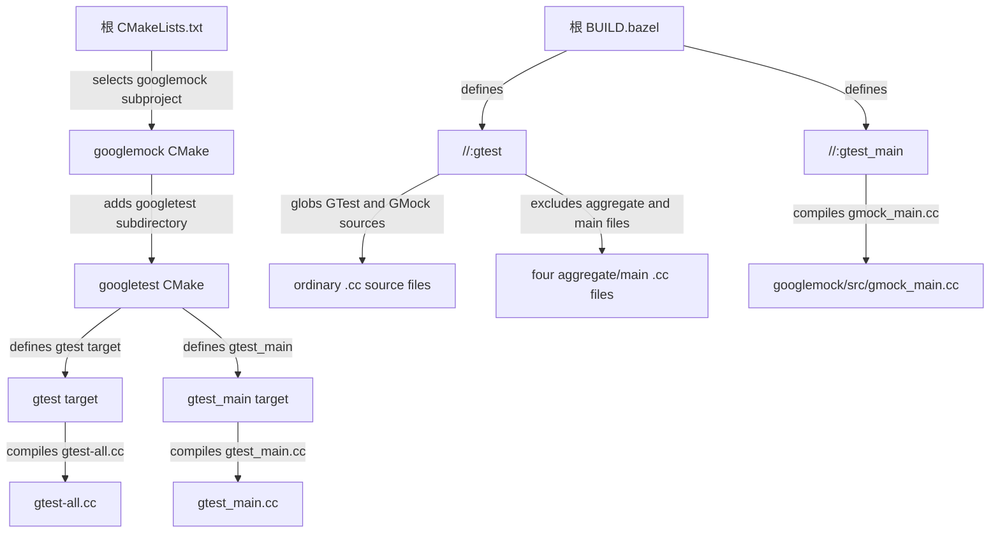
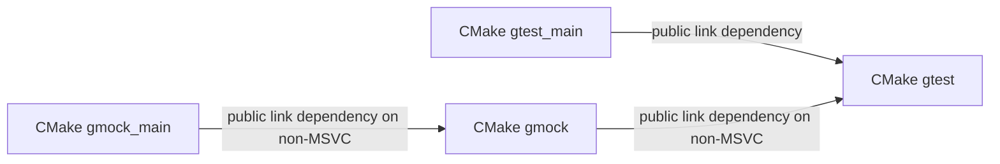

<!-- PAGE_ID: googletest_build_architecture -->
<!-- BEGIN:AUTOGEN googletest_build_architecture_main -->
# 项目结构与构建总览

> 源码基线：5feffc24e4d6c49608d241d53cacb2c8143d2beb（分支 test）。本页的结论以该提交中的实际文件为准。

## 本页结论

本次分析固定在用户指定的 test 分支当前提交 5feffc24e4d6c49608d241d53cacb2c8143d2beb，对应 GoogleTest / GoogleMock 1.18.0 源码。该分支与仓库默认分支 main 不同；本次生成只写入 test 分支的新验证目录，不把 main 的源码状态混进来。

GoogleTest 和 GoogleMock 不是简单的两个互相独立子目录：顶层 CMake 默认通过 BUILD_GMOCK 进入 GoogleMock 工程，GoogleMock 的 CMake 又会把 GoogleTest 子工程加入当前构建。Bazel 则在根 BUILD.bazel 定义了一个同时包含 GoogleTest 与 GoogleMock 普通实现源文件的 gtest 库目标。两套构建系统的 target 边界不同。

## CMake 工程入口

根 CMakeLists.txt 根据 BUILD_GMOCK 决定添加 googlemock 或 googletest 子目录；BUILD_GMOCK 默认值为 ON。进入 googlemock/CMakeLists.txt 后，会通过 gtest_dir 再添加 GoogleTest 子目录。因此当默认配置启用 GoogleMock 时，GoogleTest target 也会进入同一个 CMake 构建图。

## CMake 的库与入口 target

| Target | 编译输入 | target 依赖 |
|---|---|---|
| gtest | googletest/src/gtest-all.cc | 可选 Abseil / RE2 配置 |
| gtest_main | googletest/src/gtest_main.cc | PUBLIC 链接 gtest |
| gmock（非 MSVC） | googlemock/src/gmock-all.cc | PUBLIC 链接 gtest |
| gmock_main（非 MSVC） | googlemock/src/gmock_main.cc | PUBLIC 链接 gmock |
| gmock（MSVC） | gtest-all.cc + gmock-all.cc | 在同一 target 内直接编译聚合文件 |
| gmock_main（MSVC） | gtest-all.cc + gmock-all.cc + gmock_main.cc | 在同一 target 内直接编译聚合文件 |

## Bazel 的 target 结构

根 BUILD.bazel 的 //:gtest 目标通过 glob 收集 googletest/src 和 googlemock/src 的普通实现源文件，并显式排除 gtest-all.cc、gtest_main.cc、gmock-all.cc、gmock_main.cc。//:gtest_main 则把 googlemock/src/gmock_main.cc 作为自己的编译输入，并依赖 //:gtest。

这意味着 Bazel 中的 //:gtest 是合并承载 GTest/GMock 实现源的库目标；它不等价于 CMake 的 gtest target。特别是 Bazel 的 //:gtest_main 文件来源与 CMake 的 gtest_main 不同，必须分别阅读 BUILD 文件，不能只依据 target 名称推断实现。

## 构建选择关系图

<!-- DIAGRAM_ID: build-selection-and-targets -->

第二张图补充 CMake target 的链接边；MSVC 分支不套用非 MSVC 的 target_link_libraries 结论，MSVC 分支在上表中单独列出。

## 关系类型不要混用

- 编译输入：某个 target 把源文件编译进自身。
- 子目录包含：CMake 把另一个子工程纳入当前配置。
- 链接依赖：target 之间建立链接关系。
- glob / exclude：Bazel 在分析阶段选择或排除源文件。

这些关系不能都画成泛化的“依赖”箭头。尤其不能把 gtest-all.cc 的文本 include 当成 CMake target_link_libraries。

## 证据范围与未执行事项

本页分析了顶层 CMake、GoogleTest/GoogleMock 子工程 CMake 与根 BUILD.bazel 的目标边界。未执行 CMake configure/build、Bazel query/build 或 CTest；这里的构建关系来自构建描述文件，不代表编译已经通过。

更多细节见 [聚合编译单元与测试入口](02_聚合编译单元与测试入口.md)、[项目自测目标](06_GoogleMock集成与项目自测目标.md)。

## 源码引用

[CMakeLists.txt:31-36](https://github.com/maxiaoxuxu/googletest/blob/5feffc24e4d6c49608d241d53cacb2c8143d2beb/CMakeLists.txt#L31-L36)

[BUILD.bazel:190-198](https://github.com/maxiaoxuxu/googletest/blob/5feffc24e4d6c49608d241d53cacb2c8143d2beb/BUILD.bazel#L190-L198)

[googlemock/CMakeLists.txt:45-50](https://github.com/maxiaoxuxu/googletest/blob/5feffc24e4d6c49608d241d53cacb2c8143d2beb/googlemock/CMakeLists.txt#L45-L50)

[googletest/CMakeLists.txt:120-124](https://github.com/maxiaoxuxu/googletest/blob/5feffc24e4d6c49608d241d53cacb2c8143d2beb/googletest/CMakeLists.txt#L120-L124)

[googletest/CMakeLists.txt:138-150](https://github.com/maxiaoxuxu/googletest/blob/5feffc24e4d6c49608d241d53cacb2c8143d2beb/googletest/CMakeLists.txt#L138-L150)

[BUILD.bazel:100-123](https://github.com/maxiaoxuxu/googletest/blob/5feffc24e4d6c49608d241d53cacb2c8143d2beb/BUILD.bazel#L100-L123)

[BUILD.bazel:108-122](https://github.com/maxiaoxuxu/googletest/blob/5feffc24e4d6c49608d241d53cacb2c8143d2beb/BUILD.bazel#L108-L122)

<!-- END:AUTOGEN googletest_build_architecture_main -->
