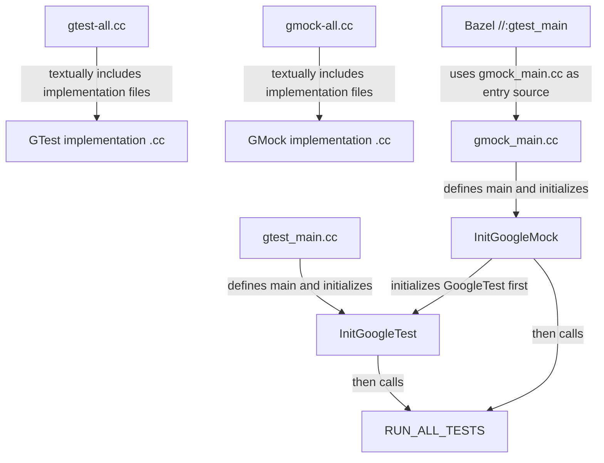

<!-- PAGE_ID: googletest_aggregate_units_entrypoints -->
<!-- BEGIN:AUTOGEN googletest_aggregate_units_entrypoints_main -->
# 聚合编译单元与测试入口

> 源码基线：5feffc24e4d6c49608d241d53cacb2c8143d2beb（分支 test）。本页的结论以该提交中的实际文件为准。

## 先区分三个完全不同的概念

**聚合编译单元（aggregate translation unit）**：把多个实现 .cc 文件通过 C++ 预处理器的文本 include 合并到一个翻译单元中编译。

**构建 target**：CMake 或 Bazel 定义的库/可执行文件目标，决定哪些文件被编译以及 target 如何链接。

**程序入口（program entry point）**：提供 main()，或者嵌入式平台的 setup()/loop()，决定进程/固件从哪里开始执行。

这三层有关联，但不是同一个东西。聚合文件本身没有定义 main()，不能把 gtest-all.cc 说成测试执行入口。

## GTest 聚合编译单元

googletest/src/gtest-all.cc 的文件注释明确说明它允许通过编译一个文件构建 GoogleTest。该文件先包含公开头文件 gtest/gtest.h，再依次包含 assertion result、death test、filepath、matchers、port、printers、test part、typed test 和 gtest.cc 等实现文件。

这是一种 unity-style compilation（统一/聚合编译）方式：被 include 的 .cc 内容最终成为 gtest-all.cc 所属的同一个 translation unit。它并不意味着这些实现模块在源码层面合并成一个逻辑模块。

## GMock 聚合编译单元

googlemock/src/gmock-all.cc 采用相同方式：先包含 gmock/gmock.h，再 include cardinalities、internal utils、matchers、spec builders 和 gmock.cc。它聚合的是 GMock 实现，不包含 GTest 的全部实现；GTest 是否由同一个 target 编译，取决于具体构建系统和平台分支。

## 入口源文件与聚合源文件各司其职

| 文件 | 作用 | 是否提供普通平台 main |
|---|---|---|
| gtest-all.cc | 聚合 GTest 实现 .cc | 否 |
| gmock-all.cc | 聚合 GMock 实现 .cc | 否 |
| gtest_main.cc | 初始化 GTest 并调用 RUN_ALL_TESTS | 是 |
| gmock_main.cc | 初始化 GMock（同时初始化 GTest）并调用 RUN_ALL_TESTS | 是 |

普通平台的 gtest_main.cc 定义 main(argc, argv)，依次调用 InitGoogleTest 和 RUN_ALL_TESTS。gmock_main.cc 定义自己的 main，调用 InitGoogleMock，再调用 RUN_ALL_TESTS。InitGoogleMockImpl 内部先调用 InitGoogleTest，因此使用 gmock_main 时不需要再额外调用 InitGoogleTest。

**聚合编译单元不是程序入口**：gtest-all.cc/gmock-all.cc 负责聚合实现，gtest_main.cc/gmock_main.cc 负责提供执行入口。通常选择一个 main 提供者，或者由应用自行定义 main；不要把两个默认 main 提供者同时链接到同一个可执行文件。

## 构建系统决定入口文件的实际归属

- CMake 的 gtest_main target 编译 googletest/src/gtest_main.cc。
- CMake 的非 MSVC gmock_main target 编译 googlemock/src/gmock_main.cc，并 PUBLIC 链接 gmock。
- 当前 test 分支的 Bazel //:gtest_main target 编译 googlemock/src/gmock_main.cc，且依赖 //:gtest。也就是说 Bazel target 名称虽叫 gtest_main，入口实现实际来自 GMock 的 main 文件。
- CMake 的 MSVC gmock/gmock_main 分支会把 GTest/GMock 聚合源一起作为编译输入；不能把非 MSVC 的链接图套用到 MSVC。

## 平台入口并非都叫 main()

gtest_main.cc 还包含平台条件分支：ESP8266 / ESP32 / NRF52+ARDUINO 使用 setup()/loop()；QuRT 使用不带 argc/argv 的 main()；普通平台使用 main(argc, argv)。gmock_main.cc 的 Arduino 分支使用 setup()/loop()，Windows Mobile 分支使用 _tmain，其余平台使用 main(argc, argv)。

## 聚合与入口关系图

<!-- DIAGRAM_ID: aggregate-units-and-entrypoints -->

## 重要边界

当前页面解释的是源码/构建定义所表达的结构，不是本机实际链接产物的反汇编。没有执行 CMake、Bazel 编译，也没有检查最终链接 map；因此不能据此声称特定构建配置最终只生成了哪些 object file。下一页继续解释 TEST 宏如何把测试项注册到运行时注册表。

## 源码引用

[googletest/src/gtest-all.cc:32-50](https://github.com/maxiaoxuxu/googletest/blob/5feffc24e4d6c49608d241d53cacb2c8143d2beb/googletest/src/gtest-all.cc#L32-L50)

[googletest/src/gtest_main.cc:59-65](https://github.com/maxiaoxuxu/googletest/blob/5feffc24e4d6c49608d241d53cacb2c8143d2beb/googletest/src/gtest_main.cc#L59-L65)

[googlemock/src/gmock-all.cc:32-49](https://github.com/maxiaoxuxu/googletest/blob/5feffc24e4d6c49608d241d53cacb2c8143d2beb/googlemock/src/gmock-all.cc#L32-L49)

[googlemock/src/gmock_main.cc:61-72](https://github.com/maxiaoxuxu/googletest/blob/5feffc24e4d6c49608d241d53cacb2c8143d2beb/googlemock/src/gmock_main.cc#L61-L72)

[googlemock/src/gmock.cc:135-152](https://github.com/maxiaoxuxu/googletest/blob/5feffc24e4d6c49608d241d53cacb2c8143d2beb/googlemock/src/gmock.cc#L135-L152)

[BUILD.bazel:190-198](https://github.com/maxiaoxuxu/googletest/blob/5feffc24e4d6c49608d241d53cacb2c8143d2beb/BUILD.bazel#L190-L198)

<!-- END:AUTOGEN googletest_aggregate_units_entrypoints_main -->
