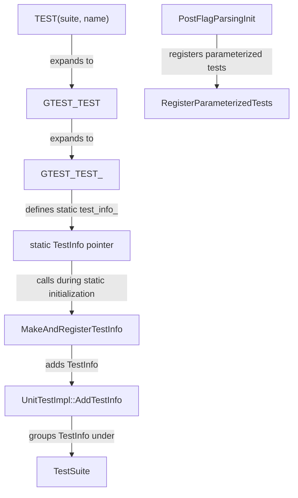

<!-- PAGE_ID: googletest_static_test_registration -->
<!-- BEGIN:AUTOGEN googletest_static_test_registration_main -->
# TEST 宏与静态注册机制

> 源码基线：5feffc24e4d6c49608d241d53cacb2c8143d2beb（分支 test）。本页的结论以该提交中的实际文件为准。

## TEST 宏不是运行时扫描目录

GoogleTest 的常规 TEST / TEST_F 不是在 RUN_ALL_TESTS() 时扫描源码目录或加载测试文件。宏展开会定义一个具体的测试类，并在命名空间作用域定义静态 TestInfo 指针成员。该静态成员初始化表达式调用 MakeAndRegisterTestInfo()，将测试元信息登记到全局 UnitTestImpl。

这就是**静态注册（static registration）**：C++ 的静态对象初始化在 main() 之前完成。UnitTestImpl::AddTestInfo 的源码注释也明确说明该路径在 main() 到达前注册 TEST / TEST_F。

## 宏展开层级

1. TEST(suite, name) 默认展开为 GTEST_TEST(suite, name)。
2. GTEST_TEST 再调用内部宏 GTEST_TEST_，传入基础类 testing::Test。
3. GTEST_TEST_ 生成测试类，类名由 suite 和 name 组合；测试体成为该类的 TestBody()。
4. 宏在类外定义静态 test_info_ 成员。
5. test_info_ 初始化时调用 MakeAndRegisterTestInfo()，并传入 CodeLocation、Fixture 类型 ID、Suite setup/teardown 函数以及 TestFactoryImpl。

## 注册对象关系

<!-- DIAGRAM_ID: test-macro-static-registration -->

## UnitTestImpl 如何保存 TestInfo

MakeAndRegisterTestInfo() 新建 TestInfo，然后调用 GetUnitTestImpl()->AddTestInfo(...)。AddTestInfo() 使用 TestInfo 中的 test_suite_name_、type_param 等信息取得或创建相应 TestSuite，再把 TestInfo 添加到该 suite。

因此运行时结构不是“一个全局平铺的测试函数数组”这么简单，而是至少包含 UnitTestImpl → TestSuite → TestInfo 的层次。TestInfo 持有测试名称、源文件位置、fixture 类型信息、factory 和运行结果等元数据。

## 参数化测试有一个不同的注册时点

TEST_P / INSTANTIATE_TEST_SUITE_P 先把模式测试与参数化实例记录在 ParameterizedTestSuiteRegistry 等注册结构中。PostFlagParsingInit() 在命令行参数解析后调用 RegisterParameterizedTests()，再把参数/类型组合展开为普通测试项。

所以需要区分：
- 常规 TEST / TEST_F：由静态初始化在 main() 前注册。
- 参数化测试实例：在 PostFlagParsingInit() 中显式展开注册。

把二者统称为“RUN_ALL_TESTS 时动态收集测试”是不准确的。

## 源码引用

[googletest/include/gtest/internal/gtest-internal.h:1516-1559](https://github.com/maxiaoxuxu/googletest/blob/5feffc24e4d6c49608d241d53cacb2c8143d2beb/googletest/include/gtest/internal/gtest-internal.h#L1516-L1559)

[googletest/src/gtest-internal-inl.h:681-710](https://github.com/maxiaoxuxu/googletest/blob/5feffc24e4d6c49608d241d53cacb2c8143d2beb/googletest/src/gtest-internal-inl.h#L681-L710)

[googletest/include/gtest/gtest.h:2199-2206](https://github.com/maxiaoxuxu/googletest/blob/5feffc24e4d6c49608d241d53cacb2c8143d2beb/googletest/include/gtest/gtest.h#L2199-L2206)

[googletest/include/gtest/internal/gtest-internal.h:1546-1559](https://github.com/maxiaoxuxu/googletest/blob/5feffc24e4d6c49608d241d53cacb2c8143d2beb/googletest/include/gtest/internal/gtest-internal.h#L1546-L1559)

[googletest/src/gtest.cc:2851-2861](https://github.com/maxiaoxuxu/googletest/blob/5feffc24e4d6c49608d241d53cacb2c8143d2beb/googletest/src/gtest.cc#L2851-L2861)

[googletest/src/gtest.cc:5813-5840](https://github.com/maxiaoxuxu/googletest/blob/5feffc24e4d6c49608d241d53cacb2c8143d2beb/googletest/src/gtest.cc#L5813-L5840)

<!-- END:AUTOGEN googletest_static_test_registration_main -->
