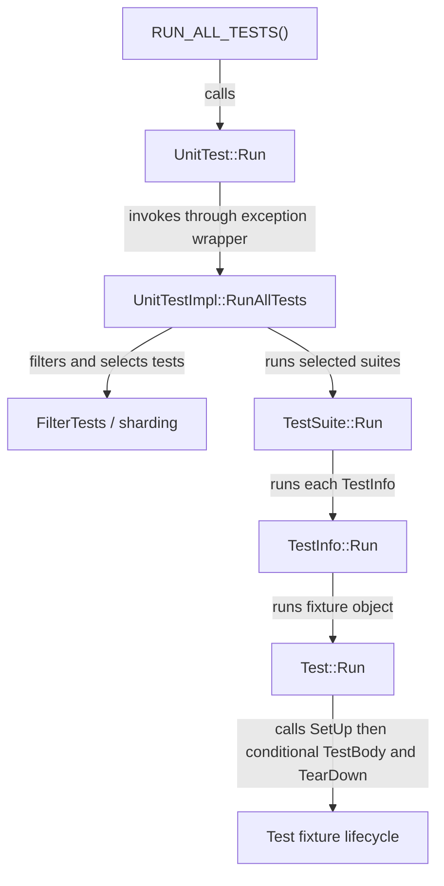

<!-- PAGE_ID: googletest_runtime_dispatch -->
<!-- BEGIN:AUTOGEN googletest_runtime_dispatch_main -->
# RUN_ALL_TESTS 执行链路

> 源码基线：5feffc24e4d6c49608d241d53cacb2c8143d2beb（分支 test）。本页的结论以该提交中的实际文件为准。

## RUN_ALL_TESTS() 是薄包装，不是完整调度器

公开头文件中的 RUN_ALL_TESTS() 内联函数只调用 UnitTest::GetInstance()->Run()。UnitTest::Run() 再通过异常处理包装调用 UnitTestImpl::RunAllTests()，并将执行成功/失败映射为返回值 0/1。

实际调度、过滤、迭代、suite 遍历和测试执行都在 UnitTestImpl::RunAllTests() 及其下游对象方法中完成。

## 主调用链

<!-- DIAGRAM_ID: run-all-tests-call-chain -->

## 调度层职责

| 层级 | 关键职责 |
|---|---|
| UnitTest::Run | 建立异常处理边界，调用内部执行函数并转换退出状态 |
| UnitTestImpl::RunAllTests | 后置初始化、无测试检查、shard/filter、list-tests、repeat/shuffle、环境与 suite 调度 |
| TestSuite::Run | suite 级 setup/teardown、TestInfo 遍历和 suite 级 fail-fast |
| TestInfo::Run | 处理单个测试的 listener 通知、fixture factory、运行与销毁 |
| Test::Run | SetUp、条件执行 TestBody、TearDown |

## Filter、sharding 与 list-tests 的位置

RunAllTests() 在执行 suite 前先处理 death-test 子进程分支与 sharding，再调用 FilterTests() 确定实际要运行的测试项。如果指定 list-tests，则在过滤之后列出匹配项并提前返回，不进入正常执行迭代。

这意味着“测试已注册”不等于“测试一定执行”：还受到 filter、disabled、shard、list-tests 和其他运行标志影响。

## Fixture 执行顺序

TestInfo::Run() 创建 fixture 对象后检查 fatal failure / skip 状态；符合条件才调用 Test::Run()。Test::Run() 先调用 SetUp()，仅当 setup 没有 fatal failure 且未 skip 时调用 TestBody()。随后 TearDown() 仍会执行，以尽可能清理资源。

## 退出路径

RunAllTests() 在迭代结束后依据测试结果累计 failed 状态，最后返回成功/失败；UnitTest::Run() 将其转换为 0 或 1。空测试程序和无匹配测试不是同一个情况：没有任何测试链接与过滤后没有测试被选中，分别由不同的标志和分支控制。

## 源码引用

[googletest/include/gtest/gtest.h:2336-2349](https://github.com/maxiaoxuxu/googletest/blob/5feffc24e4d6c49608d241d53cacb2c8143d2beb/googletest/include/gtest/gtest.h#L2336-L2349)

[googletest/src/gtest.cc:5985-6005](https://github.com/maxiaoxuxu/googletest/blob/5feffc24e4d6c49608d241d53cacb2c8143d2beb/googletest/src/gtest.cc#L5985-L6005)

[googletest/src/gtest.cc:5618-5630](https://github.com/maxiaoxuxu/googletest/blob/5feffc24e4d6c49608d241d53cacb2c8143d2beb/googletest/src/gtest.cc#L5618-L5630)

[googletest/src/gtest.cc:5985-6005](https://github.com/maxiaoxuxu/googletest/blob/5feffc24e4d6c49608d241d53cacb2c8143d2beb/googletest/src/gtest.cc#L5985-L6005)

[googletest/src/gtest.cc:6050-6174](https://github.com/maxiaoxuxu/googletest/blob/5feffc24e4d6c49608d241d53cacb2c8143d2beb/googletest/src/gtest.cc#L6050-L6174)

[googletest/src/gtest.cc:3055-3125](https://github.com/maxiaoxuxu/googletest/blob/5feffc24e4d6c49608d241d53cacb2c8143d2beb/googletest/src/gtest.cc#L3055-L3125)

[googletest/src/gtest.cc:2896-2942](https://github.com/maxiaoxuxu/googletest/blob/5feffc24e4d6c49608d241d53cacb2c8143d2beb/googletest/src/gtest.cc#L2896-L2942)

[googletest/src/gtest.cc:2767-2790](https://github.com/maxiaoxuxu/googletest/blob/5feffc24e4d6c49608d241d53cacb2c8143d2beb/googletest/src/gtest.cc#L2767-L2790)

<!-- END:AUTOGEN googletest_runtime_dispatch_main -->
