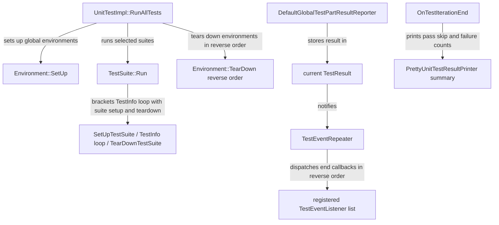

<!-- PAGE_ID: googletest_fixtures_events_reporting -->
<!-- BEGIN:AUTOGEN googletest_fixtures_events_reporting_main -->
# Fixture、全局环境与事件报告

> 源码基线：5feffc24e4d6c49608d241d53cacb2c8143d2beb（分支 test）。本页的结论以该提交中的实际文件为准。

## 三个作用域不能混为一谈

GoogleTest 至少有三个不同的 setup/teardown 作用域：

| 作用域 | Setup | 运行对象 | Teardown |
|---|---|---|---|
| 全局 Environment | Environment::SetUp | 本轮所有选中的 TestSuite | Environment::TearDown |
| TestSuite | SetUpTestSuite | 本 suite 的 TestInfo 列表 | TearDownTestSuite |
| 单个 Test | fixture SetUp | TestBody | fixture TearDown |

全局环境由 RunAllTests() 管理。默认 repeat 策略下，环境可能只在第一次迭代前 setup、最后一次迭代后 teardown；如果配置为每轮重新创建，则每轮都执行。teardown 使用 reverse iterator，按注册顺序的逆序清理。

TestSuite::Run() 在 suite 的测试项循环前后执行 SetUpTestSuite/TearDownTestSuite。单个 fixture 的构造和析构由 TestInfo::Run() 管理；SetUp 失败会阻止 TestBody，但 TearDown 仍负责清理。

## 全局环境和测试 suite 调度

<!-- DIAGRAM_ID: environment-and-event-reporting -->

## 断言结果如何流向 listener

DefaultGlobalTestPartResultReporter::ReportTestPartResult() 把 TestPartResult 加入当前 TestResult，再通过 TestEventRepeater 分发 OnTestPartResult。当前测试上下文由 UnitTestImpl 中的 current_test_info_ / current_test_suite_ 等状态确定；如果没有正在运行的 TestInfo，断言可能记入 ad-hoc result。

## Listener 回调顺序不是统一正序

TestEventRepeater 将开始类回调按 listener 注册顺序正向发送；结束类回调（例如 OnTestEnd、OnTestSuiteEnd、OnTestProgramEnd）采用逆序发送。OnTestIterationEnd 也采用逆序。自定义 listener 如果成对申请/释放资源，应该把这个方向纳入设计，而不能假设所有事件都正向遍历。

## 结果打印时机

PrettyUnitTestResultPrinter 在 OnTestIterationEnd 阶段汇总执行数、通过数、跳过数以及失败测试。XML 和 streaming listener 的安装发生在 PostFlagParsingInit()，之后由事件 repeater 驱动。

## 失败、skip 与 fail-fast 的边界

- 全局 Environment setup 失败或 skip，会影响后续 suite 是否执行。
- Suite setup 的 ad-hoc result 失败或 skip，会使 suite 内测试项被标记为 skip。
- 单测试 SetUp 失败或 skip，会跳过 TestBody，但仍执行 TearDown 清理。
- fail-fast 可以在 suite 级或单测试级提前跳过剩余项。
- 环境 teardown 仍按自身条件执行，不等于任意失败都立即退出进程。

## 源码引用

[googletest/src/gtest.cc:6050-6174](https://github.com/maxiaoxuxu/googletest/blob/5feffc24e4d6c49608d241d53cacb2c8143d2beb/googletest/src/gtest.cc#L6050-L6174)

[googletest/src/gtest.cc:3055-3125](https://github.com/maxiaoxuxu/googletest/blob/5feffc24e4d6c49608d241d53cacb2c8143d2beb/googletest/src/gtest.cc#L3055-L3125)

[googletest/src/gtest.cc:1090-1111](https://github.com/maxiaoxuxu/googletest/blob/5feffc24e4d6c49608d241d53cacb2c8143d2beb/googletest/src/gtest.cc#L1090-L1111)

[googletest/src/gtest.cc:3916-3978](https://github.com/maxiaoxuxu/googletest/blob/5feffc24e4d6c49608d241d53cacb2c8143d2beb/googletest/src/gtest.cc#L3916-L3978)

[googletest/src/gtest.cc:3700-3745](https://github.com/maxiaoxuxu/googletest/blob/5feffc24e4d6c49608d241d53cacb2c8143d2beb/googletest/src/gtest.cc#L3700-L3745)

<!-- END:AUTOGEN googletest_fixtures_events_reporting_main -->
