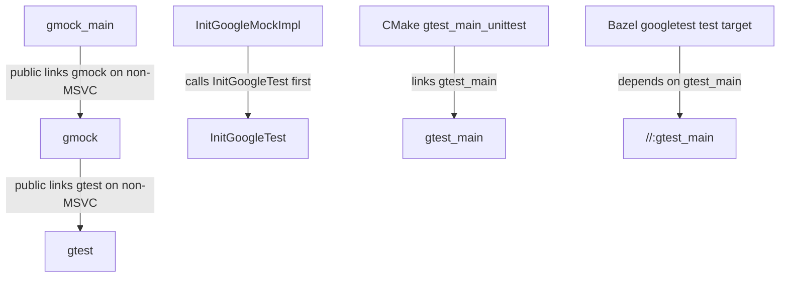

<!-- PAGE_ID: googletest_build_test_matrix_gmock -->
<!-- BEGIN:AUTOGEN googletest_build_test_matrix_gmock_main -->
# GoogleMock 集成与项目自测目标

> 源码基线：5feffc24e4d6c49608d241d53cacb2c8143d2beb（分支 test）。本页的结论以该提交中的实际文件为准。

## GoogleMock 依赖 GoogleTest，不是旁路独立 runner

GoogleMock 的初始化函数 InitGoogleMockImpl() 会先调用 InitGoogleTest(argc, argv)，确保 GTest 已初始化，再继续解析 GoogleMock 自己的命令行参数。gmock_main.cc 也直接调用 InitGoogleMock，之后调用 RUN_ALL_TESTS。因此 GMock 使用的是同一套 GoogleTest 测试注册、调度与结果报告基础设施。

## CMake 的平台分支

非 MSVC 下，gmock 编译 gmock-all.cc 并 PUBLIC 链接 gtest；gmock_main 编译 gmock_main.cc 并 PUBLIC 链接 gmock。MSVC 下，CMake 直接把 gtest-all.cc 和 gmock-all.cc 加到 gmock target，把这两个聚合文件再加上 gmock_main.cc 放入 gmock_main target。这里存在真实的 platform branch，不应只保留非 MSVC 的一条路径。

## 项目自测 target 与用户测试程序的入口库是两层东西

CMakeLists 中的 cxx_test(...) 声明是项目自身测试可执行文件的构建规则；例如 gtest_main_unittest target 使用 gtest_main。Bazel 的 googletest/test/BUILD.bazel 中也存在依赖 //:gtest_main 的测试 target。测试源文件是否自带 main、使用 gtest_main 还是只依赖 gtest，需要逐 target 检查，不能将所有测试目标假定为相同链接方式。

## GMock 集成与自测 target 关系图

<!-- DIAGRAM_ID: gmock-integration-and-test-targets -->

## 如何阅读项目自测配置

- 先从根 CMakeLists / BUILD.bazel 找到 target 定义，再追踪它的 srcs、link_libraries/deps 和平台 select。
- 再从 googletest/test/BUILD.bazel、googlemock/test/BUILD.bazel 追踪测试源文件、是否自带 main、依赖的 GTest/GMock target。
- 对 death test、无异常/无 RTTI、shared library 等特殊 target，单独记录编译定义和编译选项；不能从普通 target 推断其行为。
- 目标名字中出现 test，不代表它已在本次执行。只有实际 configure/build/CTest/Bazel test 的日志才能证明项目自测通过。

## 本次验证边界

本轮只读取构建描述和源码，未执行 CMake configure/build、Bazel build/test 或 CTest。页面中的 target 是源码静态分析结果，不代表构建或项目自测已通过。

## 源码引用

[googlemock/src/gmock.cc:135-155](https://github.com/maxiaoxuxu/googletest/blob/5feffc24e4d6c49608d241d53cacb2c8143d2beb/googlemock/src/gmock.cc#L135-L155)

[googletest/CMakeLists.txt:195-225](https://github.com/maxiaoxuxu/googletest/blob/5feffc24e4d6c49608d241d53cacb2c8143d2beb/googletest/CMakeLists.txt#L195-L225)

[googlemock/CMakeLists.txt:84-104](https://github.com/maxiaoxuxu/googletest/blob/5feffc24e4d6c49608d241d53cacb2c8143d2beb/googlemock/CMakeLists.txt#L84-L104)

[googletest/test/BUILD.bazel:45-115](https://github.com/maxiaoxuxu/googletest/blob/5feffc24e4d6c49608d241d53cacb2c8143d2beb/googletest/test/BUILD.bazel#L45-L115)

<!-- END:AUTOGEN googletest_build_test_matrix_gmock_main -->
