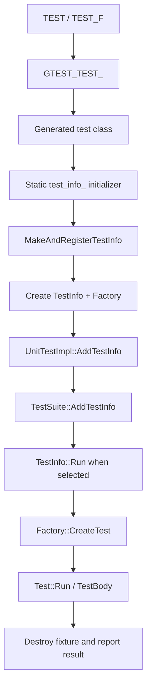

<!-- PAGE_ID: googletest_retest_02_registration -->

相关源码文件

- [gtest.h:2200-2202](https://github.com/maxiaoxuxu/googletest/blob/a8380b01a25ebdb130097b607b3afed2a58d04ba/googletest/include/gtest/gtest.h#L2200-L2202)
- [gtest-internal.h:1515-1558](https://github.com/maxiaoxuxu/googletest/blob/a8380b01a25ebdb130097b607b3afed2a58d04ba/googletest/include/gtest/internal/gtest-internal.h#L1515-L1558)
- [gtest.cc:2850-2860](https://github.com/maxiaoxuxu/googletest/blob/a8380b01a25ebdb130097b607b3afed2a58d04ba/googletest/src/gtest.cc#L2850-L2860)
- [gtest-internal-inl.h:668-690](https://github.com/maxiaoxuxu/googletest/blob/a8380b01a25ebdb130097b607b3afed2a58d04ba/googletest/src/gtest-internal-inl.h#L668-L690)
- [gtest.h:534-665](https://github.com/maxiaoxuxu/googletest/blob/a8380b01a25ebdb130097b607b3afed2a58d04ba/googletest/include/gtest/gtest.h#L534-L665)
- [gtest.cc:2898-2934](https://github.com/maxiaoxuxu/googletest/blob/a8380b01a25ebdb130097b607b3afed2a58d04ba/googletest/src/gtest.cc#L2898-L2934)

# TEST 宏、静态注册与测试实例化

> 本页追踪普通 `TEST` 从预处理宏展开、静态注册，到真正执行时创建 Fixture 实例的完整路径。源码基准固定为 `a8380b01a25ebdb130097b607b3afed2a58d04ba`。

<!-- BEGIN:AUTOGEN googletest_retest_02_registration_pipeline -->
## 1. 宏入口：TEST 与 TEST_F 的区别

公开头文件将 `TEST(test_suite_name, test_name)` 转发给 `GTEST_TEST`；`TEST_F` 则转发给 `GTEST_TEST_F`，并把用户定义的 Fixture 类型及其 TypeId 传入底层宏。也就是说，二者共用注册骨架，但父类和 Fixture 类型标识不同。([gtest.h:2200-2202](https://github.com/maxiaoxuxu/googletest/blob/a8380b01a25ebdb130097b607b3afed2a58d04ba/googletest/include/gtest/gtest.h#L2200-L2202))

## 2. GTEST_TEST_ 生成什么

`GTEST_TEST_` 为每个测试生成一个独立类，类名由 suite 名和 test 名拼接得到。该类继承传入的 `parent_class`，实现私有虚函数 `TestBody()`，并声明静态成员 `test_info_`。

关键是静态成员的定义：初始化表达式调用 `MakeAndRegisterTestInfo(...)`，同时传入 suite/test 名称、源代码位置、Fixture 类型 ID、Suite SetUp/TearDown 函数以及一个 `TestFactoryImpl`。因此宏展开不仅定义了测试类，也在静态初始化路径上触发注册。([gtest-internal.h:1515-1558](https://github.com/maxiaoxuxu/googletest/blob/a8380b01a25ebdb130097b607b3afed2a58d04ba/googletest/include/gtest/internal/gtest-internal.h#L1515-L1558))

## 3. 注册链：TestInfo → UnitTestImpl → TestSuite

`MakeAndRegisterTestInfo` 先创建 `TestInfo`，再调用 `GetUnitTestImpl()->AddTestInfo(...)`。([gtest.cc:2850-2860](https://github.com/maxiaoxuxu/googletest/blob/a8380b01a25ebdb130097b607b3afed2a58d04ba/googletest/src/gtest.cc#L2850-L2860))

`UnitTestImpl::AddTestInfo` 将测试加入由 suite 名称定位的 `TestSuite`：它调用 `GetTestSuite(...)->AddTestInfo(test_info)`。该函数还会在支持文件系统的平台上记录程序启动时的原始工作目录；源码注释明确说明这是为了 thread-safe death tests，且注册发生在 `main()` 之前。([gtest-internal-inl.h:668-690](https://github.com/maxiaoxuxu/googletest/blob/a8380b01a25ebdb130097b607b3afed2a58d04ba/googletest/src/gtest-internal-inl.h#L668-L690))

三个对象的职责不同：

| 对象 | 保存/管理的内容 | 生命周期职责 |
|---|---|---|
| `TestInfo` | suite/test 名、源位置、Fixture 类型 ID、Factory、运行过滤状态和结果 | 描述一个已注册测试 |
| `UnitTestImpl` | 内部注册和 suite 管理入口 | 找到或创建目标 TestSuite 并接收 TestInfo |
| `TestSuite` | 同一 suite 下的 TestInfo 集合 | 管理 suite 级测试集合与相关生命周期 |

`TestInfo` 的字段和接口说明它持有创建测试对象所需的 Factory；`Run()` 则是创建、运行、记录结果并销毁测试对象的执行入口。([gtest.h:534-665](https://github.com/maxiaoxuxu/googletest/blob/a8380b01a25ebdb130097b607b3afed2a58d04ba/googletest/include/gtest/gtest.h#L534-L665))

## 4. 注册时不创建 Fixture：执行阶段才调用 Factory

`TestInfo::Run()` 在测试被选中后设置当前测试信息、通知监听器，然后通过 `factory_->CreateTest` 创建具体 `Test` 对象。若构造阶段没有致命失败或 Skip，才调用 `test->Run()`；随后销毁实例、记录耗时并通知测试结束。([gtest.cc:2898-2934](https://github.com/maxiaoxuxu/googletest/blob/a8380b01a25ebdb130097b607b3afed2a58d04ba/googletest/src/gtest.cc#L2898-L2934))

因此需要区分两个时点：

- **注册阶段**：创建测试元数据 `TestInfo`，并把它放进对应 `TestSuite`；此时保存 Factory，不创建每个测试的 Fixture 实例。
- **执行阶段**：测试被选中后，`TestInfo::Run()` 才调用 Factory 创建实例并运行 `TestBody()`。

## 5. 端到端关系

**源码事实**：宏定义静态注册入口；注册函数创建 TestInfo 并将其加入 TestSuite；TestInfo::Run 在执行时才调用 Factory 创建实例。

**推导**：GoogleTest 将“测试发现/登记”和“测试对象实例化/执行”分离，使测试元数据可以先被统一管理，再由过滤、分片和运行流程决定是否创建实例。这里的“静态注册”描述的是普通 TEST/TEST_F 的宏生成路径；参数化测试还存在单独的注册展开阶段，不能把本页流程不加区分地套用到所有测试类型。
<!-- END:AUTOGEN googletest_retest_02_registration_pipeline -->
