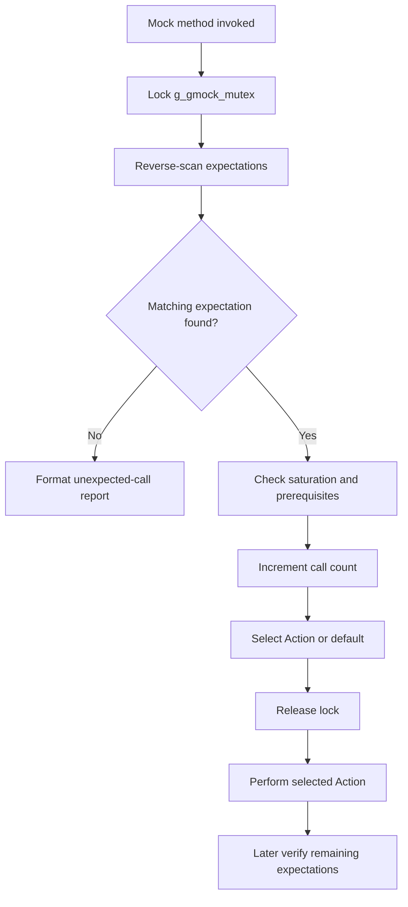

<!-- PAGE_ID: googletest_retest_08_expectations -->

相关源码文件

- [gmock-spec-builders.h:30-57](https://github.com/maxiaoxuxu/googletest/blob/a8380b01a25ebdb130097b607b3afed2a58d04ba/googlemock/include/gmock/gmock-spec-builders.h#L30-L57)
- [gmock-spec-builders.h:780-815](https://github.com/maxiaoxuxu/googletest/blob/a8380b01a25ebdb130097b607b3afed2a58d04ba/googlemock/include/gmock/gmock-spec-builders.h#L780-L815)
- [gmock-spec-builders.h:1218-1262](https://github.com/maxiaoxuxu/googletest/blob/a8380b01a25ebdb130097b607b3afed2a58d04ba/googlemock/include/gmock/gmock-spec-builders.h#L1218-L1262)
- [gmock-spec-builders.h:1635-1692](https://github.com/maxiaoxuxu/googletest/blob/a8380b01a25ebdb130097b607b3afed2a58d04ba/googlemock/include/gmock/gmock-spec-builders.h#L1635-L1692)
- [gmock-spec-builders.cc:128-145](https://github.com/maxiaoxuxu/googletest/blob/a8380b01a25ebdb130097b607b3afed2a58d04ba/googlemock/src/gmock-spec-builders.cc#L128-L145)
- [gmock-spec-builders.cc:389-425](https://github.com/maxiaoxuxu/googletest/blob/a8380b01a25ebdb130097b607b3afed2a58d04ba/googlemock/src/gmock-spec-builders.cc#L389-L425)
- [gmock-spec-builders.h:1705-1748](https://github.com/maxiaoxuxu/googletest/blob/a8380b01a25ebdb130097b607b3afed2a58d04ba/googlemock/include/gmock/gmock-spec-builders.h#L1705-L1748)

# EXPECT_CALL 的匹配、调用计数与 Action 选择

> 本页区分 expectation（必须满足的调用约束）与 default action（没有匹配期望时的默认行为），并追踪一次 Mock 调用如何选择期望、更新状态和执行 Action。

<!-- BEGIN:AUTOGEN googletest_retest_08_expectations_pipeline -->
## 1. EXPECT_CALL 与 ON_CALL 不是一回事

头文件注释给出了两种声明的语义：`ON_CALL(mock, Method(...))` 用于指定默认 Action；`EXPECT_CALL(mock, Method(...))` 用于声明对 Mock 方法调用的 expectation。EXPECT_CALL 可以附加 `.With()`、`.Times()`、`.InSequence()`、`.After()`、`.WillOnce()`、`.WillRepeatedly()` 和 `.RetiresOnSaturation()` 等子句。([gmock-spec-builders.h:30-57](https://github.com/maxiaoxuxu/googletest/blob/a8380b01a25ebdb130097b607b3afed2a58d04ba/googlemock/include/gmock/gmock-spec-builders.h#L30-L57))

可以这样理解：

| 声明 | 主要作用 | 是否建立调用次数约束 |
|---|---|---|
| `ON_CALL` | 为匹配的调用配置默认行为 | 本身不声明必须发生的调用 |
| `EXPECT_CALL` | 建立可验证的调用期望，并可配置匹配、次数、顺序和 Action | 是，具体次数/范围由 cardinality 决定 |

## 2. 匹配阶段：为什么后注册的 expectation 先检查

`UntypedFindMatchingExpectation()` 在持有 `g_gmock_mutex` 的临界区内查找匹配项。注释解释了原因：匹配 expectation 与选定 Action 必须作为原子事务完成，否则另一个线程可能同时调用同一 Mock 方法并破坏状态。([gmock-spec-builders.h:1635-1664](https://github.com/maxiaoxuxu/googletest/blob/a8380b01a25ebdb130097b607b3afed2a58d04ba/googlemock/include/gmock/gmock-spec-builders.h#L1635-L1664))

`FindMatchingExpectationLocked()` 从 `untyped_expectations_` 的 `rbegin()` 到 `rend()` 反向遍历，返回第一个 `ShouldHandleArguments(args)` 为真的 expectation。因此，当多个 expectation 都可能匹配时，检查顺序是后注册者优先，而不是简单的先注册先匹配。([gmock-spec-builders.h:1665-1692](https://github.com/maxiaoxuxu/googletest/blob/a8380b01a25ebdb130097b607b3afed2a58d04ba/googlemock/include/gmock/gmock-spec-builders.h#L1665-L1692))

## 3. 前置依赖、调用计数与饱和

`ShouldHandleArguments()` 将三项条件合并为“未退休、全部前置 expectation 已满足、参数 matcher 匹配”；其中 `AllPrerequisitesAreSatisfied()` 会递归检查前置关系。([gmock-spec-builders.h:1122-1134](https://github.com/maxiaoxuxu/googletest/blob/a8380b01a25ebdb130097b607b3afed2a58d04ba/googlemock/include/gmock/gmock-spec-builders.h#L1122-L1134))

Expectation 维护 cardinality 和 call count，并提供 `IsSatisfied()`、`IsSaturated()`、`IsOverSaturated()` 等状态判断；这些状态分别用于判断次数是否达到要求、是否达到上限以及是否超出上限。([gmock-spec-builders.h:780-815](https://github.com/maxiaoxuxu/googletest/blob/a8380b01a25ebdb130097b607b3afed2a58d04ba/googlemock/include/gmock/gmock-spec-builders.h#L780-L815))、([gmock-spec-builders.h:1122-1134](https://github.com/maxiaoxuxu/googletest/blob/a8380b01a25ebdb130097b607b3afed2a58d04ba/googlemock/include/gmock/gmock-spec-builders.h#L1122-L1134))

当匹配成功后，`GetActionForArguments()` 分两条路径：

1. **已经 Saturated**：增加调用计数、记录 excessive call 信息，并返回空 Action 指针，后续采用默认行为。
2. **尚未 Saturated**：增加调用计数、退休所有前置 expectation；如果启用了 `RetiresOnSaturation` 且本次调用使其达到饱和，则退休当前 expectation；最后按调用状态取得当前 Action。([gmock-spec-builders.h:1218-1262](https://github.com/maxiaoxuxu/googletest/blob/a8380b01a25ebdb130097b607b3afed2a58d04ba/googlemock/include/gmock/gmock-spec-builders.h#L1218-L1262))

`InSequence` / `After` 建立的前置关系最终由 `AllPrerequisitesAreSatisfied()` 检查：实现遍历 immediate prerequisites，只要发现一个尚未满足的前置 expectation，就返回 false；否则继续沿前置关系检查。([gmock-spec-builders.cc:128-145](https://github.com/maxiaoxuxu/googletest/blob/a8380b01a25ebdb130097b607b3afed2a58d04ba/googlemock/src/gmock-spec-builders.cc#L128-L145))

## 4. 锁保护状态，但不在锁内执行用户 Action

源码特别强调：匹配与 Action 选择需要在同一临界区完成；真正执行 Action 则必须离开临界区，因为 Action 可能调用任意用户函数，甚至再次调用 Mock 函数，持锁执行可能造成死锁。([gmock-spec-builders.h:1635-1664](https://github.com/maxiaoxuxu/googletest/blob/a8380b01a25ebdb130097b607b3afed2a58d04ba/googlemock/include/gmock/gmock-spec-builders.h#L1635-L1664))

选出的 Action 随后由 `PerformAction()` 执行；如果选中的是默认行为，则走 `PerformDefaultAction()`。这形成了“锁内确定调用归属与行为，锁外执行用户逻辑”的边界。([gmock-spec-builders.h:1720-1748](https://github.com/maxiaoxuxu/googletest/blob/a8380b01a25ebdb130097b607b3afed2a58d04ba/googlemock/include/gmock/gmock-spec-builders.h#L1720-L1748))

## 5. 期望校验与失败报告

`VerifyAndClearExpectationsLocked()` 遍历该 Mock 方法上的 expectations：超出上限的调用已经在发生时报告；未满足次数要求的 expectation 则构造说明信息，并通过 GoogleTest 的 `Expect(false, ...)` 报告非致命失败。函数随后交换并清理 expectation 集合。([gmock-spec-builders.cc:389-425](https://github.com/maxiaoxuxu/googletest/blob/a8380b01a25ebdb130097b607b3afed2a58d04ba/googlemock/src/gmock-spec-builders.cc#L389-L425))

因此，调用过程中的 unexpected/excessive call 与最终的 unmet expectation 是不同问题：前者在调用匹配时暴露，后者在校验时发现调用次数不足。

## 6. 一次 Mock 调用的决策路径

**源码事实**：匹配顺序是反向遍历；匹配状态和 Action 指针在互斥锁保护下确定；Action 本身不在该临界区执行；未满足次数的 expectation 会在校验阶段报告。

**推导**：GoogleMock 将“并发安全的 expectation 状态更新”和“可能重入用户代码的 Action 执行”分开，避免在全局 Mock 锁内执行不受控的用户逻辑。
<!-- END:AUTOGEN googletest_retest_08_expectations_pipeline -->
