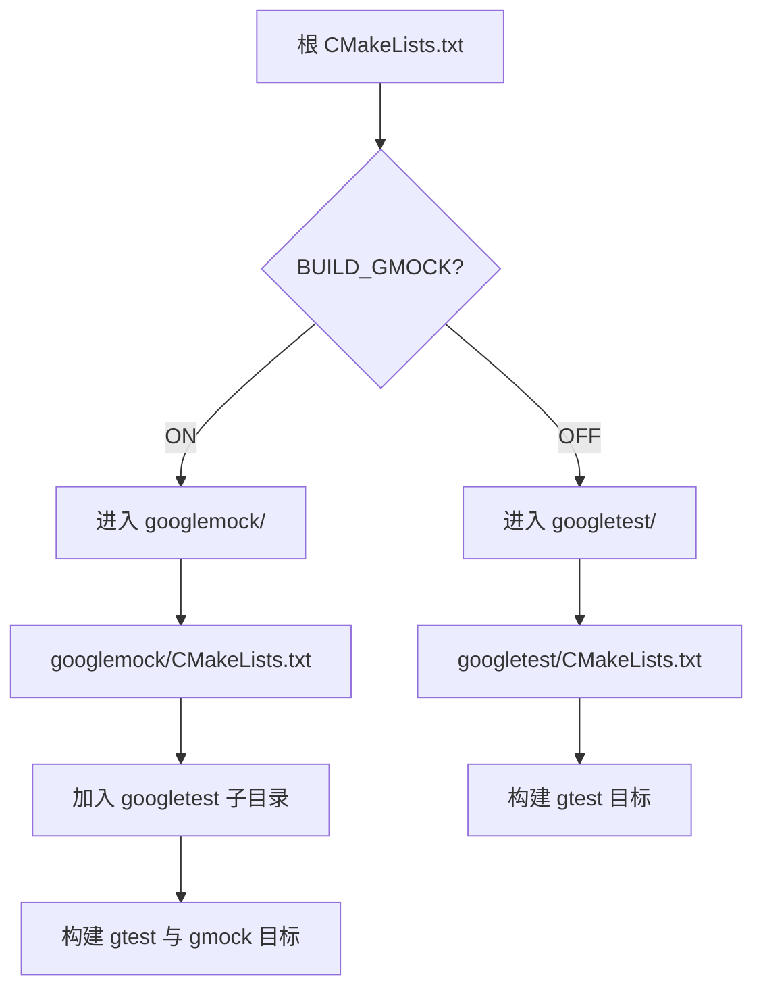

<!-- PAGE_ID: googletest_01_build_graph -->

📚 Relevant source files

- [CMakeLists.txt:19-36](https://github.com/maxiaoxuxu/googletest/blob/277cfa07d637aac85a388d1cb0c6adb585a1432e/CMakeLists.txt#L19-L36)
- [googletest/CMakeLists.txt:18-20](https://github.com/maxiaoxuxu/googletest/blob/277cfa07d637aac85a388d1cb0c6adb585a1432e/googletest/CMakeLists.txt#L18-L20)
- [googletest/CMakeLists.txt:123-150](https://github.com/maxiaoxuxu/googletest/blob/277cfa07d637aac85a388d1cb0c6adb585a1432e/googletest/CMakeLists.txt#L123-L150)
- [googletest/CMakeLists.txt:189-220](https://github.com/maxiaoxuxu/googletest/blob/277cfa07d637aac85a388d1cb0c6adb585a1432e/googletest/CMakeLists.txt#L189-L220)
- [googlemock/CMakeLists.txt:13-18](https://github.com/maxiaoxuxu/googletest/blob/277cfa07d637aac85a388d1cb0c6adb585a1432e/googlemock/CMakeLists.txt#L13-L18)
- [googlemock/CMakeLists.txt:50-50](https://github.com/maxiaoxuxu/googletest/blob/277cfa07d637aac85a388d1cb0c6adb585a1432e/googlemock/CMakeLists.txt#L50)
- [googlemock/CMakeLists.txt:83-105](https://github.com/maxiaoxuxu/googletest/blob/277cfa07d637aac85a388d1cb0c6adb585a1432e/googlemock/CMakeLists.txt#L83-L105)

# CMake 构建入口与目标依赖

> **Related Pages**: [聚合编译单元与测试入口](02_aggregate_units.md)

---

<!-- BEGIN:AUTOGEN googletest_01_build_graph_cmake -->
## CMake 构建入口与库目标

根目录 `CMakeLists.txt` 将 `BUILD_GMOCK` 默认设为 `ON`。开启时加入 `googlemock/`，关闭时直接加入 `googletest/`。所以默认发行版包含 GoogleMock，但也支持仅构建 GoogleTest（`CMakeLists.txt:19-36`）。

GoogleTest 的 `gtest` 目标以 `src/gtest-all.cc` 为编译输入；`gtest_main` 目标以 `src/gtest_main.cc` 为入口并公开链接 `gtest`。因此，使用框架提供的 main 时链接 `gtest_main`，需要自定义 main 时可直接链接 `gtest`（`googletest/CMakeLists.txt:123-150`）。

GoogleMock 的 CMake 文件先加入 GoogleTest 子目录（`googlemock/CMakeLists.txt:50`）。在非 MSVC 分支中，`gmock` 编译 `gmock-all.cc` 并链接 `gtest`，`gmock_main` 编译 `gmock_main.cc` 并链接 `gmock`。MSVC 分支则将 GTest 与 GMock 的聚合源文件直接组合到目标中，不能把非 MSVC 的链接关系不加区分地套用到 MSVC（`googlemock/CMakeLists.txt:83-105`）。

`gtest_build_tests` 与 `gmock_build_tests` 默认均为 `OFF`；启用后才会注册各自项目的自测目标。GoogleTest 测试区块中调用 `enable_testing()`，并声明多个 `cxx_test` / Python 测试（`googletest/CMakeLists.txt:18-20,189-220`；`googlemock/CMakeLists.txt:13-18,129-150`）。

可按配置尝试：`cmake -S . -B build -Dgtest_build_tests=ON -Dgmock_build_tests=ON`，随后 `cmake --build build` 和 `ctest --test-dir build --output-on-failure`。**本轮没有执行 CMake configure/build/CTest**，这里只整理源码所支持的复现命令。

Sources: [CMakeLists.txt:19-36](https://github.com/maxiaoxuxu/googletest/blob/277cfa07d637aac85a388d1cb0c6adb585a1432e/CMakeLists.txt#L19-L36), [googletest/CMakeLists.txt:123-150](https://github.com/maxiaoxuxu/googletest/blob/277cfa07d637aac85a388d1cb0c6adb585a1432e/googletest/CMakeLists.txt#L123-L150), [googlemock/CMakeLists.txt:50-105](https://github.com/maxiaoxuxu/googletest/blob/277cfa07d637aac85a388d1cb0c6adb585a1432e/googlemock/CMakeLists.txt#L50-L105), [googletest/CMakeLists.txt:189-220](https://github.com/maxiaoxuxu/googletest/blob/277cfa07d637aac85a388d1cb0c6adb585a1432e/googletest/CMakeLists.txt#L189-L220), [googlemock/CMakeLists.txt:129-150](https://github.com/maxiaoxuxu/googletest/blob/277cfa07d637aac85a388d1cb0c6adb585a1432e/googlemock/CMakeLists.txt#L129-L150)
<!-- END:AUTOGEN googletest_01_build_graph_cmake -->

---
