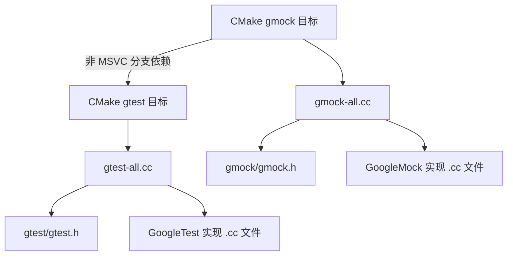

<!-- PAGE_ID: googletest_02_aggregate_units -->

📚 Relevant source files

- [gtest-all.cc:33-49](https://github.com/maxiaoxuxu/googletest/blob/277cfa07d637aac85a388d1cb0c6adb585a1432e/googletest/src/gtest-all.cc#L33-L49)
- [gmock-all.cc:33-46](https://github.com/maxiaoxuxu/googletest/blob/277cfa07d637aac85a388d1cb0c6adb585a1432e/googlemock/src/gmock-all.cc#L33-L46)
- [gtest_main.cc:59-64](https://github.com/maxiaoxuxu/googletest/blob/277cfa07d637aac85a388d1cb0c6adb585a1432e/googletest/src/gtest_main.cc#L59-L64)
- [gmock_main.cc:61-72](https://github.com/maxiaoxuxu/googletest/blob/277cfa07d637aac85a388d1cb0c6adb585a1432e/googlemock/src/gmock_main.cc#L61-L72)
- [googletest/CMakeLists.txt:123-150](https://github.com/maxiaoxuxu/googletest/blob/277cfa07d637aac85a388d1cb0c6adb585a1432e/googletest/CMakeLists.txt#L123-L150)
- [googlemock/CMakeLists.txt:83-105](https://github.com/maxiaoxuxu/googletest/blob/277cfa07d637aac85a388d1cb0c6adb585a1432e/googlemock/CMakeLists.txt#L83-L105)

# 聚合编译单元与测试入口

> **Related Pages**: [CMake 构建入口与目标依赖](01_build_graph.md)

---

<!-- BEGIN:AUTOGEN googletest_02_aggregate_units_composition -->
## 聚合编译单元与 main 入口

`gtest-all.cc` 的注释说明它用于“编译单个文件构建 GoogleTest”的场景：先包含公开头文件 `gtest/gtest.h`，再包含 assertion result、death test、filepath、matchers、port、printers、test part、typed test 和 `gtest.cc` 等实现文件（`googletest/src/gtest-all.cc:33-49`）。

`gmock-all.cc` 承担类似职责：包含 `gmock/gmock.h`，随后纳入 cardinalities、internal utils、matchers、spec builders 和 `gmock.cc` 等实现（`googlemock/src/gmock-all.cc:33-46`）。这属于源码级聚合编译单元，不意味着框架内部只有一个功能模块。

普通平台下，`gtest_main.cc` 定义 `main(int argc, char** argv)`，调用 `testing::InitGoogleTest(&argc, argv)`，然后返回 `RUN_ALL_TESTS()`（`googletest/src/gtest_main.cc:59-64`）。它还为 Arduino 类平台和 QuRT 等环境提供条件编译入口，因此普通平台的 main 不是所有平台唯一的入口形式。

`gmock_main.cc` 普通平台入口调用 `testing::InitGoogleMock(&argc, argv)` 后执行 `RUN_ALL_TESTS()`。源码注释明确说明 `InitGoogleMock()` 同时负责初始化 GoogleTest，不需要再单独调用 `InitGoogleTest()`（`googlemock/src/gmock_main.cc:61-72`）。

构建映射上，`gtest` 以 `gtest-all.cc` 为输入、`gtest_main` 以 `gtest_main.cc` 为输入并链接 `gtest`；非 MSVC 下 `gmock` 以 `gmock-all.cc` 为输入并链接 `gtest`，`gmock_main` 以 `gmock_main.cc` 为输入并链接 `gmock`（`googletest/CMakeLists.txt:123-150`；`googlemock/CMakeLists.txt:83-105`）。

分析时应区分**实现源文件、聚合编译单元、CMake 库目标和测试程序入口**四个层次，尤其注意 MSVC 与非 MSVC 的目标组织差异。

Sources: [gtest-all.cc:33-49](https://github.com/maxiaoxuxu/googletest/blob/277cfa07d637aac85a388d1cb0c6adb585a1432e/googletest/src/gtest-all.cc#L33-L49), [gmock-all.cc:33-46](https://github.com/maxiaoxuxu/googletest/blob/277cfa07d637aac85a388d1cb0c6adb585a1432e/googlemock/src/gmock-all.cc#L33-L46), [gtest_main.cc:59-64](https://github.com/maxiaoxuxu/googletest/blob/277cfa07d637aac85a388d1cb0c6adb585a1432e/googletest/src/gtest_main.cc#L59-L64), [gmock_main.cc:61-72](https://github.com/maxiaoxuxu/googletest/blob/277cfa07d637aac85a388d1cb0c6adb585a1432e/googlemock/src/gmock_main.cc#L61-L72), [googletest/CMakeLists.txt:123-150](https://github.com/maxiaoxuxu/googletest/blob/277cfa07d637aac85a388d1cb0c6adb585a1432e/googletest/CMakeLists.txt#L123-L150), [googlemock/CMakeLists.txt:83-105](https://github.com/maxiaoxuxu/googletest/blob/277cfa07d637aac85a388d1cb0c6adb585a1432e/googlemock/CMakeLists.txt#L83-L105)
<!-- END:AUTOGEN googletest_02_aggregate_units_composition -->

---
