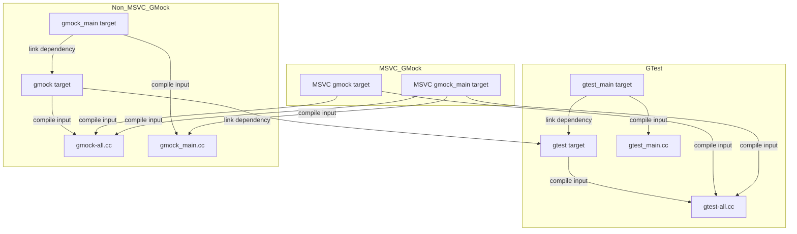
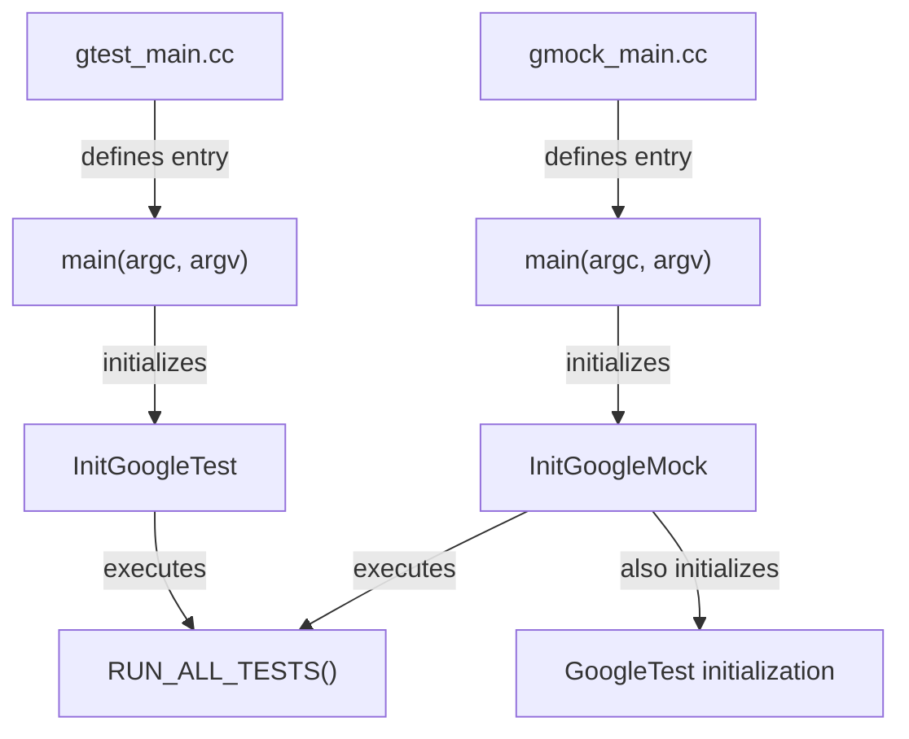

<!-- PAGE_ID: googletest_02_aggregate_units -->

📚 Relevant source files

- [gtest-all.cc:33-49](https://github.com/maxiaoxuxu/googletest/blob/277cfa07d637aac85a388d1cb0c6adb585a1432e/googletest/src/gtest-all.cc#L33-L49)
- [gmock-all.cc:33-46](https://github.com/maxiaoxuxu/googletest/blob/277cfa07d637aac85a388d1cb0c6adb585a1432e/googlemock/src/gmock-all.cc#L33-L46)
- [gtest_main.cc:34-66](https://github.com/maxiaoxuxu/googletest/blob/277cfa07d637aac85a388d1cb0c6adb585a1432e/googletest/src/gtest_main.cc#L34-L66)
- [gmock_main.cc:35-73](https://github.com/maxiaoxuxu/googletest/blob/277cfa07d637aac85a388d1cb0c6adb585a1432e/googlemock/src/gmock_main.cc#L35-L73)
- [googletest/CMakeLists.txt:123-151](https://github.com/maxiaoxuxu/googletest/blob/277cfa07d637aac85a388d1cb0c6adb585a1432e/googletest/CMakeLists.txt#L123-L151)
- [googlemock/CMakeLists.txt:85-103](https://github.com/maxiaoxuxu/googletest/blob/277cfa07d637aac85a388d1cb0c6adb585a1432e/googlemock/CMakeLists.txt#L85-L103)

# 聚合编译单元与测试入口

> **Source baseline**: `277cfa07d637aac85a388d1cb0c6adb585a1432e`

---

<!-- BEGIN:AUTOGEN googletest_02_aggregate_units_composition -->
## 1. 聚合编译单元：把多个实现文件合并到一个编译入口

`gtest-all.cc` 的文件注释说明，它用于“通过编译单个文件构建 GoogleTest”。它先包含公开头文件 `gtest/gtest.h`，再把 assertion result、death test、filepath、matchers、port、printers、test part、typed test 和 `gtest.cc` 等实现文件纳入同一个 translation unit（翻译单元）。[gtest-all.cc:33-49](https://github.com/maxiaoxuxu/googletest/blob/277cfa07d637aac85a388d1cb0c6adb585a1432e/googletest/src/gtest-all.cc#L33-L49)

`gmock-all.cc` 使用相同模式：先包含公开头文件 `gmock/gmock.h`，再包含 cardinalities、internal utils、matchers、spec builders 和 `gmock.cc` 等实现文件。[gmock-all.cc:33-46](https://github.com/maxiaoxuxu/googletest/blob/277cfa07d637aac85a388d1cb0c6adb585a1432e/googlemock/src/gmock-all.cc#L33-L46)

这里要区分：`gtest-all.cc` / `gmock-all.cc` 是**源码聚合编译单元**，而 `gtest` / `gmock` 是 CMake 定义的**构建目标**。聚合文件不是运行入口，也不表示库内部只有一个功能模块。

## 2. CMake target：编译输入与链接依赖不是同一种关系

| Target | 编译输入 | 链接依赖 / 条件 |
|---|---|---|
| `gtest` | `gtest-all.cc` | 无额外的 main target 依赖 |
| `gtest_main` | `gtest_main.cc` | `PUBLIC gtest` |
| `gmock`（非 MSVC） | `gmock-all.cc` | `PUBLIC gtest` |
| `gmock_main`（非 MSVC） | `gmock_main.cc` | `PUBLIC gmock` |
| `gmock`（MSVC） | `gtest-all.cc` + `gmock-all.cc` | 通过同一目标直接编译聚合源文件 |
| `gmock_main`（MSVC） | `gtest-all.cc` + `gmock-all.cc` + `gmock_main.cc` | 通过同一目标直接编译聚合源文件 |

GoogleTest 的 CMake 文件将 `gtest` 映射到 `gtest-all.cc`，将 `gtest_main` 映射到 `gtest_main.cc`，并声明 `gtest_main PUBLIC gtest`。[googletest/CMakeLists.txt:123-151](https://github.com/maxiaoxuxu/googletest/blob/277cfa07d637aac85a388d1cb0c6adb585a1432e/googletest/CMakeLists.txt#L123-L151)

GoogleMock 的 CMake 文件有明确的平台分支：MSVC 下，`gmock` 和 `gmock_main` 都直接编译 GTest/GMock 聚合源文件；非 MSVC 下，`gmock` 编译 `gmock-all.cc` 并链接 `gtest`，`gmock_main` 编译 `gmock_main.cc` 并链接 `gmock`。[googlemock/CMakeLists.txt:85-103](https://github.com/maxiaoxuxu/googletest/blob/277cfa07d637aac85a388d1cb0c6adb585a1432e/googlemock/CMakeLists.txt#L85-L103)

### 构建关系图

图中实线箭头都标注了关系类型：`compile input` 表示 CMake target 的编译输入，`link dependency` 表示 target 之间的链接依赖。MSVC 与非 MSVC 分开画，避免把非 MSVC 的 `target_link_libraries` 关系误套到 MSVC 分支。

## 3. 测试程序入口：gtest_main 与 gmock_main 是两条替代路径

普通平台下，`gtest_main.cc` 定义 `main(int argc, char** argv)`，调用 `testing::InitGoogleTest(&argc, argv)`，然后返回 `RUN_ALL_TESTS()`。[gtest_main.cc:59-66](https://github.com/maxiaoxuxu/googletest/blob/277cfa07d637aac85a388d1cb0c6adb585a1432e/googletest/src/gtest_main.cc#L59-L66)

普通平台下，`gmock_main.cc` 定义自己的 `main(int argc, char** argv)`，调用 `testing::InitGoogleMock(&argc, argv)`，随后执行 `RUN_ALL_TESTS()`。源码注释明确说明：`InitGoogleMock()` 同时负责初始化 GoogleTest，因此不需要再单独调用 `InitGoogleTest()`。[gmock_main.cc:64-71](https://github.com/maxiaoxuxu/googletest/blob/277cfa07d637aac85a388d1cb0c6adb585a1432e/googlemock/src/gmock_main.cc#L64-L71)

### 普通平台运行入口图

**重要推论**：`gtest_main` 和 `gmock_main` 都提供程序入口函数，因此通常是二选一的默认 main 提供者，不应把两个 main 库同时链接进同一个测试可执行文件。若测试程序需要自定义入口，也可以自行实现 `main()`，而不使用这两个默认 main target。

## 4. 平台条件会改变入口函数形态

普通平台的 `main(argc, argv)` 不是所有目标平台唯一的入口形式。源码还定义了以下条件分支：

| 源文件 | 条件 | 入口形式 | 初始化与执行 |
|---|---|---|---|
| `gtest_main.cc` | ESP8266 / ESP32 / NRF52 + ARDUINO | `setup()` / `loop()` | setup 初始化 GoogleTest；loop 执行 `RUN_ALL_TESTS()` |
| `gtest_main.cc` | `GTEST_OS_QURT` | `main()`，不接收 argc/argv | `InitGoogleTest()` 后执行 `RUN_ALL_TESTS()` |
| `gmock_main.cc` | ESP8266 / ESP32 / NRF52 + ARDUINO | `setup()` / `loop()` | setup 调用 `InitGoogleMock()`；loop 执行 `RUN_ALL_TESTS()` |
| `gmock_main.cc` | `GTEST_OS_WINDOWS_MOBILE` | `_tmain(int, TCHAR**)` | 调用 `InitGoogleMock()` 后执行 `RUN_ALL_TESTS()` |

这些不是推测：Arduino 分支在两个入口文件中都显式使用 `setup()/loop()`；GoogleTest 还为 QuRT 提供无 argc/argv 的 `main()`；GoogleMock 在 Windows Mobile 条件下使用 `_tmain`。[gtest_main.cc:34-57](https://github.com/maxiaoxuxu/googletest/blob/277cfa07d637aac85a388d1cb0c6adb585a1432e/googletest/src/gtest_main.cc#L34-L57) [gmock_main.cc:35-49](https://github.com/maxiaoxuxu/googletest/blob/277cfa07d637aac85a388d1cb0c6adb585a1432e/googlemock/src/gmock_main.cc#L35-L49) [gmock_main.cc:60-73](https://github.com/maxiaoxuxu/googletest/blob/277cfa07d637aac85a388d1cb0c6adb585a1432e/googlemock/src/gmock_main.cc#L60-L73)

## 5. 本页分析边界

- **源码事实**：两个 `*-all.cc` 文件聚合实现文件；CMake 分别定义库 target 和链接依赖；两个 `*_main.cc` 文件提供默认测试入口。
- **平台事实**：MSVC 与非 MSVC 的 GoogleMock 构建组织不同；Arduino、QuRT、Windows Mobile 存在不同入口形式。
- **推论**：`gtest_main` 与 `gmock_main` 是替代的默认入口库，因为二者分别定义入口函数；自定义 `main()` 是另一种使用方式。
- **未执行**：本轮没有运行 CMake configure/build/CTest；文中的构建命令或 target 关系不能被理解为构建已通过。

Sources: [gtest-all.cc:33-49](https://github.com/maxiaoxuxu/googletest/blob/277cfa07d637aac85a388d1cb0c6adb585a1432e/googletest/src/gtest-all.cc#L33-L49), [gmock-all.cc:33-46](https://github.com/maxiaoxuxu/googletest/blob/277cfa07d637aac85a388d1cb0c6adb585a1432e/googlemock/src/gmock-all.cc#L33-L46), [gtest_main.cc:34-66](https://github.com/maxiaoxuxu/googletest/blob/277cfa07d637aac85a388d1cb0c6adb585a1432e/googletest/src/gtest_main.cc#L34-L66), [gmock_main.cc:35-73](https://github.com/maxiaoxuxu/googletest/blob/277cfa07d637aac85a388d1cb0c6adb585a1432e/googlemock/src/gmock_main.cc#L35-L73), [googletest/CMakeLists.txt:123-151](https://github.com/maxiaoxuxu/googletest/blob/277cfa07d637aac85a388d1cb0c6adb585a1432e/googletest/CMakeLists.txt#L123-L151), [googlemock/CMakeLists.txt:85-103](https://github.com/maxiaoxuxu/googletest/blob/277cfa07d637aac85a388d1cb0c6adb585a1432e/googlemock/CMakeLists.txt#L85-L103)
<!-- END:AUTOGEN googletest_02_aggregate_units_composition -->
